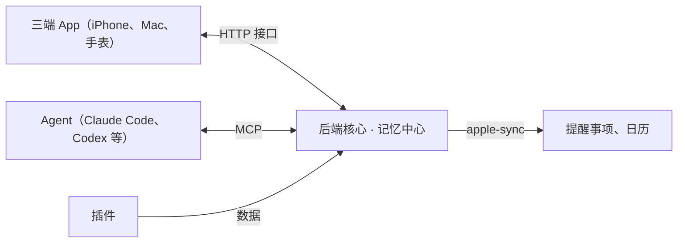

# 24 小时助手 · 后端任务说明 v0.1

## 项目目标与架构原则

后端跑在一台常开的 Mac 上，24 小时自动读取 QQ、微信、飞书等消息，用强模型提炼待办，不经人工确认就写进苹果提醒事项和日历。

（原文此处是一张架构图，未能保留，下面按下一段正文重画。）



App 只连 HTTP 接口，Agent 只连 MCP 接入口，两边读写的都是中间的记忆中心；插件把数据送进核心，苹果同步负责把待办写出去。

- **App 只负责显示**：三端 App（iPhone、Mac、手表）只通过 HTTP 接口读写数据，不含业务逻辑。
- **核心不内置 Agent**：Claude Code、Codex 等通过 MCP 接入，读写同一份记忆；换 Agent 不改核心。
- **一切皆插件**：数据源、照片分类、健康等功能都是插件，运行时可启用、停用、删除；单个插件出错不影响核心。
- **本地模型只做本地活**：Qwen3.8-27B（MLX，4 位量化）用于照片分类和截图文字识别兜底。
- **隐私**：只读取白名单里的聊天；截图留在本机，发给云端模型的只有识别出的文字。

## 技术选型与目录结构

后端用 Python 3.12+，前后端放在同一个 GitHub 仓库，后端只改 `backend/` 和 `docs/`。

| 用途 | 选型 |
| --- | --- |
| 依赖管理 | uv |
| HTTP 接口 | FastAPI |
| MCP 服务 | 官方 MCP Python SDK |
| 数据库 | SQLite（FTS5 全文检索） |
| 定时任务 | APScheduler；整个后端由 launchd 常驻 |
| 写提醒事项和日历 | Swift 命令行工具（EventKit） |
| 截图文字识别 | Apple Vision（pyobjc 或 Swift 工具） |
| 照片库 | osxphotos |
| 本地模型 | LM Studio 或 Ollama 的 OpenAI 兼容接口 |
| 飞书 | 官方 SDK lark-oapi |

没有 Mac 时可以在 Linux 或 WSL 上开发。只能在 macOS 上跑的部分（截图、EventKit、照片库、短信）先定义接口，Linux 上用假实现代替，保证全部测试能在 WSL 跑通。

```text
assistant/
├── AGENTS.md                # 本说明，给 Codex 读
├── docs/api.md              # 接口约定，前后端共用，最先写
├── backend/
│   ├── core/                # 记忆中心、插件管理、调度、HTTP、MCP
│   ├── harness/             # Agent 适配器：claude_code、codex
│   ├── prompts/             # 提示词模板，如 extract_todos.md
│   ├── plugins/             # feishu、qq_screen、wechat_screen、sms、mail、photos、health
│   ├── helpers/apple-sync/  # Swift 命令行工具
│   ├── scripts/doctor.py    # 环境自检
│   └── tests/
└── frontend/                # SwiftUI 三端 App，Claude 负责，后端不要改
```

## 核心模块

核心只做四件事：存数据、管插件、按时间表启动任务、调用 Agent。

### 记忆中心

| 表 | 存什么 | 关键字段 |
| --- | --- | --- |
| messages | 插件读到的原始消息 | plugin、chat\_name、sender、sent\_at、text、screenshot\_path、processed |
| todos | 提炼出的待办 | title、notes、due\_at、source\_plugin、source\_refs、source\_excerpt、confidence、status、dedup\_key、reminder\_id、calendar\_event\_id、created\_by |
| digests | 信息摘要 | date、plugin、summary |
| runs | 每次任务的运行记录 | job、harness、started\_at、finished\_at、status、error |
| plugins | 插件状态和配置 | enabled、config\_json、last\_run\_at |

长期记忆放在 Obsidian 目录（Markdown 文件），用 FTS5 建索引供搜索，向量检索以后再加。

### 插件系统

每个插件一个目录：`manifest.yaml` 加 `plugin.py`。

- manifest 字段：id、name、version、icon、description、platforms（macos / linux / any）、permissions（屏幕录制、辅助功能、完全磁盘访问、网络）、schedule（cron）、provides（source / cards / mcp\_tools）、config\_schema。
- 插件类按需实现 `setup`、`fetch`（数据源）、`jobs`（定时任务）、`mcp_tools`（给 Agent 的工具）、`cards`（给 App 的卡片）、`teardown`。
- 启用、停用、删除在运行时生效，不用重启；插件抛出的异常被捕获并记进 runs。
- platforms 不匹配的插件自动跳过，比如 WSL 上跳过 qq\_screen。

### 调度器

- 默认数据源每 30 分钟抓一次，待办提炼在 7:00 到 23:00 之间每 3 小时一次，都可以在 App 设置里改。
- 同一任务不重叠运行；失败按指数退避重试。

### Agent 适配器

- 统一接口：`run(prompt, mcp_config, timeout) -> RunResult`。
- 第一版实现 `claude_code`（`claude -p`）和 `codex`（`codex exec`），无界面运行，通过 MCP 接入本后端；具体参数以两者官方文档为准。
- 每类任务可以指定默认 harness；额度用完或报错时自动换另一个，并写进 runs。

## 对外接口

先写 `docs/api.md` 并定为 v1，前端只依赖这份文档；FastAPI 生成的 OpenAPI 必须和它一致。

### HTTP API（给 App）

| 方法 | 路径 | 用途 |
| --- | --- | --- |
| GET | /api/v1/status | Mac 是否在线、各 Agent 是否可用、最近一次运行 |
| GET | /api/v1/today | 今日概览：一句话总结、今日待办、插件卡片 |
| GET | /api/v1/todos | 待办列表，可按状态筛选 |
| PATCH | /api/v1/todos/{id} | 完成、修改、删除，并同步到提醒事项 |
| GET | /api/v1/digests | 按日期取信息摘要 |
| GET | /api/v1/runs | Agent 运行记录 |
| POST | /api/v1/jobs/{job\_id}/run | 立即运行一次 |
| GET | /api/v1/plugins | 插件列表和状态 |
| PATCH | /api/v1/plugins/{id} | 启用、停用、改配置 |
| DELETE | /api/v1/plugins/{id} | 删除插件 |
| GET | /api/v1/plugins/{id}/cards | 插件要显示的卡片 |
| POST | /api/v1/health/samples | iPhone App 上传健康数据 |

- 鉴权用 Bearer Token；只监听本机和 Tailscale 地址，不对公网开放。
- 卡片是服务端驱动界面的基本单位：`{type, title, data}`。type 先支持 `list`、`stat`、`chart`、`photo_grid`、`text`、`todo_list`。新插件只组合这些类型，App 不用为新插件重新编译。

### MCP 工具（给 Agent）

| 工具 | 作用 |
| --- | --- |
| messages\_get\_unprocessed | 取未处理的消息，可按来源筛选 |
| messages\_mark\_processed | 标记消息已处理 |
| todos\_add | 新增待办，核心负责去重和同步 |
| todos\_list / todos\_update | 查询和修改待办 |
| digest\_write | 写信息摘要 |
| memory\_search / memory\_read / memory\_write | 读写长期记忆 |

本地 Agent 用 stdio 连接；另外提供 streamable HTTP，方便以后从其他设备接入。

## 数据源插件

第一版做飞书和 QQ（学校通知主要在 QQ 群），其余按阶段加。所有聊天类插件只读白名单里的会话。

### feishu（Linux、macOS，阶段一）

- 用飞书开放平台的自建应用，以用户身份（user\_access\_token）OAuth 授权，自动刷新 token。
- 增量读取白名单会话（群聊和单聊）的历史消息。接口不能列出全部单聊，白名单要手动填会话 ID。
- 只用官方 SDK，不用经第三方服务器中转的库。

### qq\_screen（仅 macOS，阶段二）

- 固定脚本，不让 Agent 去点：激活 QQ 窗口，依次打开白名单里的群和联系人，截取聊天区域，向上滚动直到接上上次读到的位置，用 Apple Vision 识别中文后存进 messages，附截图路径。
- 出现群公告时打开群公告读全文；@全体成员 的消息优先。
- 用辅助功能接口或 AppleScript 定位窗口元素，坐标点击只作兜底。
- 只允许切换会话、滚动、打开群公告这几种操作，绝不输入或发送任何内容。
- 配置项：白名单；仅预览模式（只截会话列表、不点开聊天，避免消息被标为已读）。
- 已知限制：点开聊天会把消息标为已读；QQ 电脑端一般同一时间只能登录一台。

### wechat\_screen（仅 macOS，阶段二，QQ 稳定后）

和 qq\_screen 共用一套截图框架，只换微信的界面定位逻辑。微信电脑端同一时间只能登录一台。

### sms（仅 macOS，阶段三）

前提是 iPhone 开启短信转发到 Mac。只读打开 `~/Library/Messages/chat.db`（需要完全磁盘访问）；新系统的正文可能在 attributedBody 字段里，要能解析。

### mail（阶段三，可选）

IMAP 加授权码，只读。

### photos（仅 macOS，阶段三）

用 osxphotos 读照片库，交给本地 Qwen3.8-27B 分类，结果写入记忆中心并通过卡片展示，可选自动建相册。

### health（阶段三）

HealthKit 数据只能在 iPhone 和手表上读，由 iPhone App 采集后调用 `POST /api/v1/health/samples` 上传，后端负责存储和分析，详见「健康与睡眠分析」一节。

## 待办提炼流水线

全程不需要人工确认：消息进来，强模型提炼，自动写进提醒事项里单独的「AI 待办」列表。

1. 数据源插件按计划抓取消息，存进 messages。截图识别在本机完成，截图不上传。
2. 调度器到点后通过适配器启动 Claude Code 或 Codex，使用提示词模板 `prompts/extract_todos.md`。
3. Agent 通过 MCP 读取未处理消息和相关记忆，调用 `todos_add` 写待办、`digest_write` 写摘要，最后标记消息已处理。
4. 核心去重：同一件事在多个来源出现只留一条。先按 dedup\_key（标题和截止时间规范化后）匹配，再让 Agent 判断相似条目。
5. apple-sync 把新待办写进「AI 待办」列表；有具体时间的同时写进日历。
6. 每次运行写进 runs；失败重试，必要时换 harness。

### 提炼规则（写在提示词模板里，方便随时改）

- 有截止时间、或要求用户本人做某件事的，算待办。
- 纯通知，比如放假安排、讲座和活动宣传，只进信息摘要。
- 每条待办附来源和原文片段。
- 置信度低于阈值的只进摘要、不进提醒事项，阈值可配置。
- 在 App 里删除待办时，同时删除对应的提醒事项。

### apple-sync（Swift 命令行工具）

- 子命令：`reminders upsert/delete`、`calendar upsert/delete`，输入输出都用 JSON。
- 首次运行请求提醒事项和日历权限；靠保存的 reminder\_id 和 calendar\_event\_id 做到幂等，重复运行不产生重复条目。
- Linux 上用假实现，把要写入的内容存成文件，方便在 WSL 上测试整条流水线。

## 健康与睡眠分析

每天起床后自动生成一份健康简报：数字由代码算，模型（Claude 或 GPT，可切换）只负责解读和写成人话。

### 数据采集（iPhone App 负责）

- 用 HealthKit 读取睡眠阶段（深睡、核心、REM、清醒）、心率、静息心率、心率变异性（HRV）、呼吸频率、手腕温度、血氧、步数、活动能量、体能训练、最大摄氧量，以设备实际支持为准。
- 开启 HealthKit 后台推送（background delivery），手表数据同步到手机后自动上传；App 打开时再补传一次。
- 只上传按天汇总的指标和每晚的睡眠记录，不上传逐秒的原始采样。

### 后端计算（代码完成，不交给模型）

- 新增表：health\_daily（每天一行汇总指标）、sleep\_sessions（每晚入睡、醒来时间和各阶段时长）、health\_reports（生成的简报）。
- 每项指标算 7 天和 30 天个人基线，标出偏离基线较多的项，偏离阈值可配置。
- 睡眠另算作息规律性：入睡和醒来时间的波动。

### 模型解读

- 晨间简报：当晚睡眠记录上传后触发，默认最晚 10:00 兜底运行。内容：睡得怎么样、身体恢复情况、今天的训练强度建议。
- 周报：每周日晚上，总结一周的睡眠、训练和趋势。
- Agent 通过 MCP 取数：`health_get_daily`、`health_get_sleep`、`health_get_baselines`，用 `health_report_write` 写回；结合长期记忆里的训练目标给建议。
- 结果在 App 里显示为卡片，同时写进 Obsidian 长期记忆。
- 新增接口：`GET /api/v1/health/reports`，按日期取简报。

### 规则

- 不做诊断，不给用药建议，只描述数据和趋势。
- 某项指标连续多天明显异常（比如静息心率持续升高），在简报里提示关注，必要时建议就医。
- 发给云端模型的只有按天汇总的数字，不发原始数据。

## 部署与 Mac 运行环境

后端由 launchd 常驻并开机自启；下面每一项都要写进 `scripts/doctor.py` 自检。

- Mac 设置：断电恢复后自动开机、自动登录、不锁屏、显示器不睡眠（截图需要）；不接显示器时插 HDMI 欺骗器。
- 系统权限：屏幕录制、辅助功能、完全磁盘访问、提醒事项、日历、照片，逐个授权给运行后端的程序。
- QQ 和微信电脑端保持登录。
- 远程访问用 Tailscale，API 只监听本机和 Tailscale 地址。
- 本地模型由 LM Studio 或 Ollama 常驻提供。
- Token、授权码放 `.env` 或钥匙串，不进仓库。
- 每天备份 SQLite 数据库和 Obsidian 目录。

## 开发阶段与验收标准

分三个阶段，第一版以「QQ 群通知自动出现在 iPhone 提醒事项」为验收线。

（原文此处是一张路线图，未能保留，下面按正文中各插件标注的阶段整理。）

- 阶段一：feishu
- 阶段二：qq\_screen；wechat\_screen（QQ 稳定后）
- 阶段三：sms、mail（可选）、photos、health

关口一在 WSL 上用假的提醒事项验证整条流水线，关口二就是第一版验收；阶段三的插件都等第一版跑稳之后再加。

### 第一版验收

- [ ] 白名单 QQ 群里有截止时间的通知，在下一次提炼后出现在 iPhone 的「AI 待办」列表，附来源。
- [ ] 飞书白名单会话里的待办同样能自动进入。
- [ ] 同一件事在 QQ 和飞书都出现时，只生成一条待办。
- [ ] 纯通知只出现在信息摘要里。
- [ ] 停用或删除任一插件，其他功能照常；插件报错不影响核心。
- [ ] 一个 Agent 额度用完时，自动换另一个完成任务。
- [ ] 所有 HTTP 接口与 `docs/api.md` 一致，并有测试覆盖。

## 约束与禁止事项

- 不向 QQ、微信、飞书发送任何消息，也不做加好友、点赞等任何写操作。
- 不破解或解密 QQ、微信的本地数据库，不用 hook，不用 NapCat 这类第三方协议登录。
- 核心里不写死 Agent 逻辑；提示词都放在 `prompts/` 目录。
- 不修改 `frontend/` 目录。
- 截图和原始聊天只留在本机；日志里不打印 token 和完整聊天内容。
- 每个模块都要有测试；macOS 专属部分要有接口和假实现，保证在 WSL 上能跑通全部测试。
