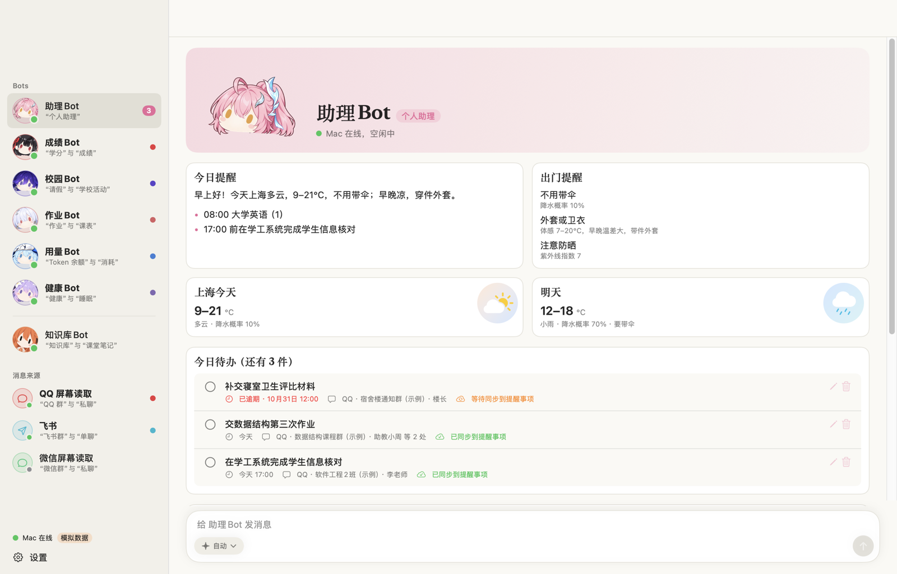

# Aemeath Bot

**An always-on computer that reads your group chats, sorts out your to-dos and reminds you of class.**

[中文](README.md) | English



School notices are scattered across a dozen QQ groups, and homework deadlines hide among hundreds of messages. Aemeath Bot lets a computer that stays on keep watch:

- It reads only the groups you choose.
- An AI turns what you actually have to do into to-dos and puts them in iPhone Reminders and Calendar.
- Plain announcements go into a daily digest instead.

It also reads your timetable, health data and monthly bills. Each area has its own Bot, and you can see them and chat with them on iPhone, iPad, Mac, Apple Watch, Android and Windows. The App's text is in Chinese.

## What it does

- **Group notices become to-dos.** It reads whitelisted QQ groups and writes the to-dos an AI extracts, with deadlines, into an "AI 待办" Reminders list; timed ones also go into Calendar. The same notice from several groups becomes one to-do. WeChat and Feishu are written but not yet tried on real accounts.
- **Timetable and class reminders.** It captures the timetable page open in your browser, reads it on the machine with OCR and reminds you 15 minutes before each class. No school password needed.
- **A morning brief.** Weather, classes, to-dos and notes, including whether to take an umbrella.
- **Health.** The phone uploads health data. The backend computes your personal baselines for sleep, resting heart rate and HRV, plus a readiness score, and writes a morning report. It describes data and does not diagnose.
- **Budget.** It imports WeChat and bank statements, categorizes them, matches refunds and tells you what is left this month. Summaries only, no payments.
- **Knowledge base.** PDFs, photos, class notes and video transcripts are organized into an Obsidian folder the Bots can search.
- **Chat.** Every Bot can answer questions and change the data it looks after. You pick the AI for each message.

## How it works

- **No AI is built into the core.** Claude Code, Codex and DeepSeek connect through MCP and share the same data and memory; when one runs out of quota, the next takes over.
- **Code computes, the model explains.** Money, health metrics and timetables are computed by tested code. Models only get the totals, so they cannot make numbers up.
- **The Apps only display.** The backend sends "cards" (lists, numbers, charts, tables, text), and the Apps draw them, so a new feature usually needs no App update.
- **It reads the screen, it does not hack.** QQ is read from screenshots with on-device OCR by a fixed script. The script only switches chats and scrolls, never types or sends, and never touches chat databases or third-party protocols.

## Privacy

- Only whitelisted chats are read.
- Screenshots and raw chats stay on the machine; cloud models only see the recognized text.
- Bills sit in a private folder no Bot can read.
- Each device has its own revocable token.
- The backend listens only on localhost and Tailscale.

## Platforms

| Part | Platform | State |
| --- | --- | --- |
| Backend | macOS | In daily use |
| Backend | Windows 10/11 | All tests pass in CI; screen reading and the logon task still need a real machine. No Apple Reminders or Calendar |
| Backend | Linux | Core and tests |
| Apps | iPhone, iPad, Mac, Apple Watch | In daily use |
| Apps | Android phones and tablets | APK built and tested in CI; not yet tried on a device |
| Apps | Windows desktop | MSI built and tested in CI; not yet tried on a machine |

## Quick start

Try the whole pipeline with synthetic data, no accounts and no cloud models:

```bash
cd backend
uv sync --locked
uv run python -m scripts.demo
```

Then see [docs/mac-setup.md](docs/mac-setup.md) or [docs/windows.md](docs/windows.md) to run it for real. The docs are in Chinese.

## License

The code is under the [MIT License](LICENSE). The Bots' images were drawn with AI and are not covered by it.

This is an unofficial personal project. It is not affiliated with Tencent QQ, WeChat or Feishu, or with any game or its rights holders. Use screen reading only on your own account and within each platform's terms. The health reports are not medical advice.
