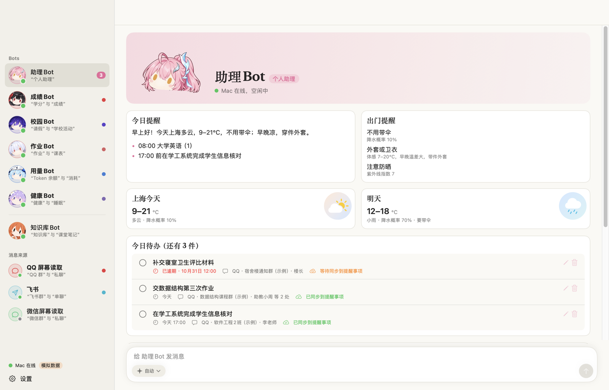
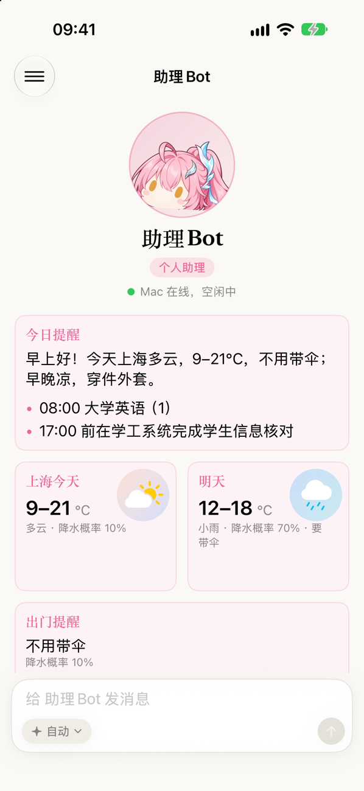
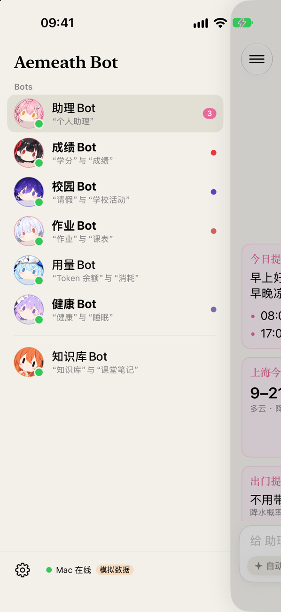
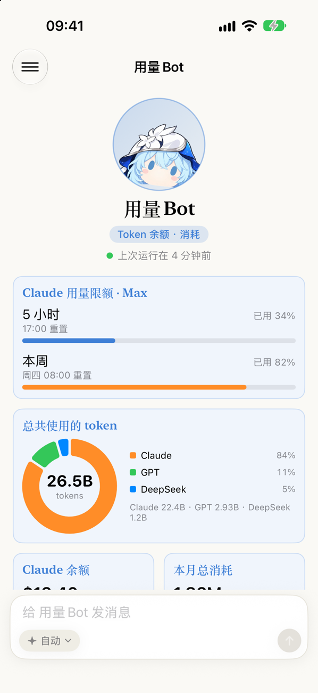
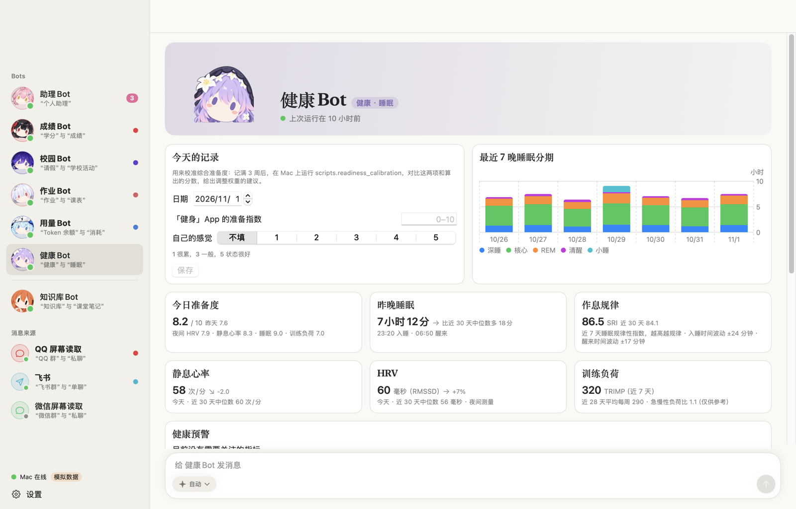
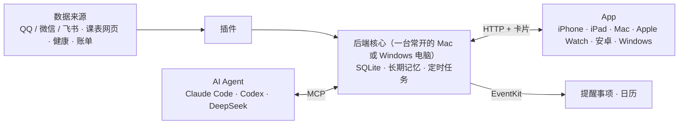

# Aemeath Bot

**一台 24 小时开着的电脑，替你读群消息、排好待办、提醒你上课。**

[](https://github.com/feixing-Aemeath/aemeath-bot/actions/workflows/backend.yml)
[](https://github.com/feixing-Aemeath/aemeath-bot/actions/workflows/frontend.yml)
[](https://github.com/feixing-Aemeath/aemeath-bot/actions/workflows/android.yml)
[](https://github.com/feixing-Aemeath/aemeath-bot/actions/workflows/desktop.yml)
[](LICENSE)

中文 | [English](README.en.md)



学校的通知散在十几个 QQ 群里，作业的截止时间夹在几百条聊天中间，一不留神就错过了。Aemeath Bot 让一台常开的电脑替你盯着：

- 它只读你指定的几个群；
- AI 把真正要你做的事提炼成待办，自动写进 iPhone 的提醒事项和日历，到点提醒你；
- 纯通知（放假安排、讲座宣传）只进每日摘要，不打扰你。

除了群消息，它还读课表、健康数据和每月账单。每一块交给一个 Bot 负责，在 iPhone、iPad、Mac、Apple Watch、安卓和 Windows 上都能看、能聊天。

## 它能做什么

- **群通知变待办**：读 QQ 白名单群，AI 提炼出待办和截止时间，自动写进「AI 待办」提醒事项列表；有具体时间的同时进日历。同一件事在几个群里都发了，只留一条。微信、飞书的接入已经写好，还没在真实账号上验证。
- **课表和上课提醒**：截取浏览器里开着的课表页面，在本机识别文字，读出每天的课，课前 15 分钟提醒。不需要你的教务账号和密码。
- **每天一份简报**：早上 6:30 写好「今日提醒」，分天气、课程、待办、注意四节；按降水概率和体感温度告诉你要不要带伞、穿什么。
- **健康**：手机自动上传健康数据，后端算出睡眠、静息心率、心率变异性的个人基线和准备度，每天早上一份健康简报。只描述数据，不做诊断。
- **记账**：导入微信和银行导出的账单，自动分类、对退款、去重，算出这个月还能花多少。只给汇总，不碰付款。
- **知识库**：PDF、照片、课堂笔记、视频文字稿整理进一个 Obsidian 文件夹，Bot 能查。
- **和 Bot 聊天**：每个 Bot 都能对话，能查、能改自己负责的数据；每句话可以选用哪个 AI。

## 每个 Bot 管什么

| Bot | 负责 |
| --- | --- |
| 助理Bot | 总待办、天气、每周回顾 |
| 作业Bot | 作业、课表 |
| 成绩Bot | 学分、成绩 |
| 校园Bot | 请假、学校活动 |
| 健康Bot | 睡眠、恢复、训练 |
| 用量Bot | AI 用量和额度 |
| 知识库Bot | 知识库、课堂笔记 |
| 记账Bot | 生活费、账单、月报 |

每个 Bot 背后是一个插件，可以随时启用、停用、删除；一个插件出错不影响别的。Bot 的形象和人设都能换成你自己的。

## 截图

| 助理Bot | Bot 列表 | 用量Bot |
| --- | --- | --- |
|  |  |  |



截图都用的是 App 自带的模拟数据。

## 怎么做到的



- **核心不绑死某一个 AI**：AI 通过 MCP 读写同一份数据和记忆。Claude Code、Codex、DeepSeek 可以互换，一个额度用完就自动换另一个。
- **代码算数字，模型写人话**：钱、健康指标、课表都由代码计算并有测试，模型只拿到算好的汇总，不会编数字。
- **App 只负责显示**：后端把内容拼成「卡片」（列表、数字、图表、表格、文字），App 照着画。加一个新功能通常只改后端，App 不用重新编译。
- **读屏幕，而不是破解**：读 QQ 用的是截图加本机文字识别，由固定脚本完成。只会切换会话和滚动，绝不打字、发送，也不碰聊天数据库或第三方协议。

## 隐私

- 只读白名单里的会话。
- 截图和原始聊天只留在本机。文字识别在本机完成，发给云端模型的只有识别出的文字。
- 账单放在没有任何 Bot 能读的私人文件夹里，模型只拿到汇总。
- 每台设备一个令牌，可以单独作废；数据库里只存哈希。
- 后端只监听本机和 Tailscale 地址，不对公网开放。

## 支持的平台

| 部分 | 平台 | 状态 |
| --- | --- | --- |
| 后端 | macOS | 每天在用 |
| 后端 | Windows 10 / 11 | CI 上全部测试通过；读屏幕和开机常驻还要在真机上校准。不能写苹果的提醒事项和日历 |
| 后端 | Linux | 能跑核心和全部测试 |
| App | iPhone、iPad、Mac、Apple Watch | 每天在用 |
| App | 安卓手机和平板 | CI 能打出安装包，测试通过；还没在真机上试过 |
| App | Windows 桌面 | CI 能打出 MSI 安装包，测试通过；还没在真机上试过 |
| AI | Claude Code、Codex、DeepSeek | 任选其一即可 |

## 快速开始

先用合成数据看一遍整条流水线。不需要任何账号，也不会请求云端模型：

```bash
cd backend
uv sync --locked
uv run python -m scripts.demo
```

在自己的电脑上跑起来：

```bash
cd backend
cp .env.example .env          # 在 .env 里设一个随机的 ASSISTANT_TOKEN
uv run python -m core         # 默认只监听 127.0.0.1:8765，所有插件停用
uv run python scripts/doctor.py
```

部署和 App：

- 常驻运行、系统权限和 QQ 设置：[Mac 部署](docs/mac-setup.md)、[Windows 部署](docs/windows.md)。
- 苹果设备上的 App：[frontend/README.md](frontend/README.md)。
- 安卓 App：[docs/android.md](docs/android.md)。
- Windows 桌面 App：[docs/desktop.md](docs/desktop.md)。

## 写一个插件

一个插件就是一个目录，里面放 `manifest.yaml` 和 `plugin.py`。manifest 声明名字、平台、权限、定时和配置项；插件类按需实现数据抓取、定时任务、给 AI 的 MCP 工具和给 App 的卡片。详见 [CONTRIBUTING.md](CONTRIBUTING.md) 和 [架构说明](docs/architecture.md)。

## 文档

- [架构](docs/architecture.md) · [HTTP 接口](docs/api.md) · [Bot 和插件](docs/bots.md)
- [屏幕读取](docs/screen-reading.md) · [课表](docs/timetable.md) · [健康方法](docs/health-methods.md) · [记账](docs/finance.md) · [知识库](docs/knowledge.md)

## 许可证与声明

代码以 [MIT 许可证](LICENSE) 发布。Bot 的形象图片由 AI 绘制，不在许可证范围内。

本项目是非官方的个人项目，和腾讯 QQ、微信、飞书没有关系，也和任何游戏及其版权方没有关系。屏幕读取只读、只读白名单里的会话；请遵守各平台的用户协议，只在自己的账号上使用。健康简报不是医疗建议，记账功能不提供投资建议。
