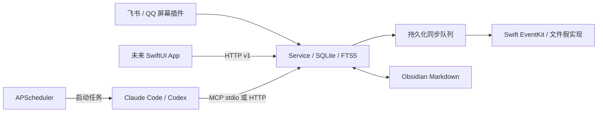

# 架构和恢复约定

HTTP App 与 Agent MCP 调用同一个 Service。SQLite 负责消息、待办、摘要、运行记录、插件状态、设置和同步 outbox；Markdown 文件是长期记忆的权威副本，FTS5 索引可以重建。stdio MCP 子进程转发到受鉴权的内部接口，不直接写数据库。

角色聊天按 manifest 贴图共用 `Bots/<角色名>/` 的只读人设与各自笔记，按用户配置读取 `知识库/<主题>/` 的资料和整理笔记；同一套 MCP 工具负责读写和保护，见[角色人设与知识库](bots.md)。

## 一致性

- 抓取一批消息以单个事务入库；唯一 `(plugin, external_id)` 保证重抓幂等。白名单在插件层和入库层检查。增量游标仅在整批入库后更新。
- 待办和 outbox 在同一个 SQLite 事务提交。规范标题（NFKC、大小写、空格、标点）和 UTC 截止时间、has_time 生成唯一 key；重复候选合并来源，并保留已完成/已删除状态。
- 每次修改递增 outbox revision。Apple 端写完后，仅删除对应 revision；同步途中新的修改仍保留。单独保存 reminder ID，日历失败不会丢失已创建的提醒事项 ID。
- 苹果工具以 `assistant-todo://<UUID>` 标记实体，同时按保存的 ID 查找。重复重试不应创建重复实体；仍需在真实 EventKit 上验收。删除也保留数据库 tombstone，旧消息重跑不会复活删除项。
- 作业不重叠，失败指数退避；每次尝试独立记录。停用插件取消运行中抓取并撤下其任务/工具。内核文件锁阻止多个核心；崩溃后运行中的记录在下次启动被标记 interrupted。
- 普通重复提交仍拒绝；本机紧急消息和按需读取使用 `jobs.submit(..., rerun=True)`，运行中合并为结束后的一次追加运行。消息 flags/outgoing 随消息事务写入，紧急 flags 首次出现才触发提炼。屏幕按需请求和每日次数持久化在插件 kv；动作前占用次数，游标和请求完成状态在入库后提交，见 [screen-reading.md](screen-reading.md)。
- 摘要同日期同来源幂等追加批次文本，避免后续批次覆盖前文。只有模型完成所有数据写入后才标记消息处理完毕。

## 插件边界

本地可信代码目录由 `manifest.yaml` 和 `plugin.py` 组成。协议见 `core/plugins.py`，测试插件示例见 `tests/test_plugins_jobs.py`。config schema 必须拒绝无关字段；凭据不放配置，由本机环境、`.env` 或受限文件提供。

插件 API：异步 `setup(context, config)`、`fetch()`、`cards()`、`teardown()`；同步 `jobs()` 返回 `{name: {cron, callback}}`，`mcp_tools()` 返回 `{name: async callable(arguments)}`。工具名以插件 id 加下划线开头时原样注册（插件拥有自己的命名空间），否则加 `plugin_<id>_` 前缀；与内置工具重名的会被拒绝。可选 `commit_fetch()` 在数据持久化后提交游标。可选的异步 `daily(day)` 返回这个插件在每日文件夹里那天的文件 `{file, bot, summary, body}`（或 None），见 [daily-folder.md](daily-folder.md)。数据源提供 `MessageInput` 对象或相同结构 dict；可能被截断的预览设 `preview=true`，核心在读到完整消息后替换它（见 screen-reading.md）。

异常隔离用于可信本地插件的故障容忍，不是恶意 Python 的安全沙箱；不得从聊天或 API 下载执行插件。删除为持久化卸载标记，不递归删除磁盘目录或历史消息。

`PluginContext.get_plugin(id)` 返回当前已启用的插件实例，未启用时为 None；用于本周回顾等组合功能读取其他插件公开的方法，避免复制分类和健康算法。这里只开放可信本地插件间的数据复用，不提供额外权限隔离。

## 隐私

MCP 不提供截图字段、截图资源或原始文件下载；只有白名单消息文字可进入模型。核心不记录模型原始输出、密钥和完整聊天。运行记录只存固定错误分类。Agent CLI 在空工作目录启动，Claude 仅开放本服务 MCP，Codex 使用只读模式、关闭 shell 和联网检索，并忽略用户 MCP 配置。CLI/模型本身的隐私、登录和远端保留策略仍由相应供应方控制。

后台任务继续使用主 `ASSISTANT_TOKEN`。Bot 对话每次 harness 尝试使用内存临时 Grant（角色 reader），结束、取消或超时撤销；没有角色的插件聊天只读系统区。自运行 Agent 建议使用带 `--reader` 的设备令牌。其他设备每台一个设备令牌（`core/tokens.py`，数据库只存 SHA-256 哈希），按 `app` / `mcp` / `health_upload` / `dav` 权限限制能访问的路由，可以单独作废；鉴权中间件每个请求都查一次数据库，所以作废立即生效。后台不执行消息中的任务本身，不提供 QQ/飞书发送操作。

## 知识库与文件权限

`core/knowledge_access.py` 发现 topic/system 区域，把首次读者固定到 knowledge_areas；默认值与 Agent 列表存 kv。BearerAuth 用 ContextVar 将 Grant 传给 MCP，memory_search 在 SQL 中过滤再 LIMIT，memory_read/write 在打开或写入前校验。Bot 只能写自己的角色记忆和每日目录，Agent reader 只能写获准系统区且不能写 Bots。MAIN 与旧无 reader 令牌保持兼容；其他待办、消息和插件工具暂不按区域限制。

`core/documents.py` 提供提取协议：macOS 调用独立 doc-text（PDFKit/Vision）和 textutil，测试使用假实现。sha256 缓存放数据目录 knowledge_text，不写用户 vault；FTS 以原文件路径索引提取文字。提取失败记录短状态，不影响其他文件。

`video_notes` 以 SQLite 视频队列和阶段检查点运行独立夜间任务；MCP 工具 video_notes_add（插件的 mcp_tools 钩子）和 App 视频接口共用插件校验；处理任务用 `self_timed` 声明自己控制时长。yt-dlp、ffmpeg、ASR 和图片 OCR 都通过 helper_process 管理进程组、超时和取消，数据目录有空间监测。结果是主题下的普通 source，沿用既有知识库权限、同步和整理流程；不另起 Agent 整理，也不把音视频或图片传给云端。见 [video-notes.md](video-notes.md)。

`knowledge_organize` 每主题一次 run_agent，用只能访问该主题的临时 Grant，专用 knowledge_note_write 只写本主题整理目录并保留用户批注。knowledge_sources 记录内容指纹、整理状态、来源笔记和长文分批进度，knowledge_notes 记录后端生成的可更新笔记。App 通过 /api/v1/knowledge… 看全部和管理区域，schema 在 core/knowledge_api.py。

权限随数据库备份；Markdown 仍是权威副本，缓存和索引可重建。本机有终端权限的 Agent 仍能直接读磁盘，HTTP/MCP 的 reader 不是操作系统隔离。详见 [knowledge.md](knowledge.md)。

## 版本与资料

实现固定官方 MCP SDK v1 主版本以免误混用 v2 API，APScheduler 固定 3.x，具体版本见 uv.lock。核对资料：

- [OpenAI 非交互模式](https://developers.openai.com/codex/noninteractive)
- [OpenAI MCP 配置](https://developers.openai.com/codex/mcp)
- [Claude Code CLI](https://code.claude.com/docs/en/cli-reference)
- [官方 MCP Python SDK v1](https://github.com/modelcontextprotocol/python-sdk/tree/v1.x)
- [飞书历史消息接口](https://open.feishu.cn/document/server-docs/im-v1/message/list)
- [飞书用户 token 刷新](https://open.feishu.cn/document/authentication-management/access-token/refresh-user-access-token)
- [APScheduler 3.x](https://apscheduler.readthedocs.io/en/3.x/userguide.html)

这些资料是实现依据，不代表实际账号授权或 Mac 设备验收结果。

## 知识库的设备入口

核心 `/dav/` 是仅数据目录内的 class-1 WebDAV，不进入 MCP/OpenAPI，不直接写 vault。鉴权中间件对它额外接受设备令牌的 HTTP Basic，dav scope 不能访问 App/MCP；PUT 绕过 App 的 50 MiB 缓冲限制，流式写临时文件后原子替换，文件/总量配额在同一 DAV 互斥区计算。

goodnotes 插件按目录/显式 mapping 对应主题，保存 goodnotes_files 写出 SHA 以保护用户文件。class_photos 用 PluginContext.get_plugin 读取启用课表的 timetable_days；课外图片只看元数据，课内候选才经 photo-export 和 Documents 的本机 OCR。class_photos_files 保存 PhotoKit ID 与课程/推测依据，避免反复导出。两者调用 Knowledge.sync 标 pending，不直接运行 Agent；主题无读者不进入夜间整理。设备设置、协议限制、存储和故障行为见 [webdav.md](webdav.md)。

## 私人记账插件

[finance](finance.md) 默认停用，以标准插件 jobs/mcp_tools/cards/daily 钩子接入，不新增依赖。读取私人主题根目录的本地账单，代码计算、SQLite 幂等导入，再同盘硬链接加 unlink 安全归档；同名后缀保留用户文件，失败留收件箱。finance_transactions、finance_imports、finance_files、finance_rules、finance_reports 记录账本、导入、状态、类别规则及报表快照。CSV、XLSX 和 ZIP 上传仅限无读者主题；Knowledge.sync 对无读者主题的所有格式标 skipped 且无错误，绝不进入知识库整理。

权限由插件在工具入口检查 current_grant：只有记账 Bot、MAIN、旧无 reader/kind 令牌可看明细和改账，其他 Bot 只能读无姓名汇总。PluginManager 支持可选 state_error() 动态状态，财务主题有读者时显示错误、卡片与 doctor 说明原因，操作重新校验。finance_report 临时 Grant 限定本周期汇总输入/写回，先生成本地数字月报，再让 context.run_agent 解读；失败保留数字、runs 仅固定分类。每日仅写合计和条数。

记账用户输入不保存原文，防止一次性解压密码进入 messages/chat_messages；当前输入仅供当轮 Agent 使用。finance_unlock 在内存登记当轮密码以遮盖 chat_reply，结束即清除，不传外部进程参数、不存配置或账本。CLI/模型服务自身留存仍属于外部边界。完整测试使用假账单和 FakeExtractor，没有真实银行、支付平台或文档提取验收。
