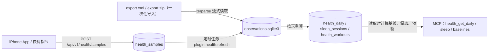

# 健康与睡眠分析：计算方法

适用代码：`backend/plugins/health/`（插件 id `health`）。本文说明每个算法怎么算、用哪些参数、有哪些限制，以及参考了哪些文献。

**这些指标只描述可穿戴设备记录的数据和趋势，不是医学诊断。** 预警文案只写「建议关注」，不下结论，也不给用药或就医建议。全部计算由确定性代码完成：不调用任何模型，也不访问任何外部服务。同样的输入和配置，结果总是一样的。

## 1. 数据流与存储



- **两种来源，一套内部结构。** 上传的样本和导出文件里的记录都先转换成同一种「观测」：`(kind, start, end, value, label, source, device_class)`，时间统一为 UTC 秒，数值换算成每种 kind 的标准单位。之后的按天汇总只认这一种结构，所以两条路径算出的 `health_daily`、`sleep_sessions` 完全一致（测试 `test_uploads_give_the_same_rows_as_the_export` 覆盖）。
- **观测单独存放**在 `<data_dir>/health/observations.sqlite3`。多年的心率读数有上百万条，放进主库会让主库和每天的备份都变得很大；这些观测可以从 `health_samples`（上传，在主库里，会被备份）和原始导出文件重新生成。派生表 `health_daily`（每天一行）、`sleep_sessions`（每晚一行）、`health_workouts`（每次训练一行）放在主库，随每日备份保存。
- **重算范围**：新上传的样本只重算受影响的日期（时区偏移加上睡眠日，前后各留余量），再顺延 30 天重算 TRIMP（某天的静息心率会影响之后 30 天的 TRIMP，见 6.1 节）。时区、日界、去重优先级等影响存储结果的设置一旦变化，或者代码改变了按天计算的方法（`config.py` 里的 `DERIVATION` 版本号，例如版本 2 把小睡算进总睡眠），定时任务会全量重算；阈值和预警规则在读取时才计算，修改后立即生效，不需要重算。
- **导入 export.xml**：用 `xml.etree.ElementTree.iterparse` 流式读取，每处理完一个顶层元素就清空，内存占用和文件大小无关。可以直接读 `export.zip`，不用解压；中文系统导出的文件名是 `导出.xml`，也能识别。`<Me>`（出生日期、性别、血型等）从不读取。实测（合成数据）：700 MB、5 年、149 万条观测的导出文件，导入加全量重算共 51 秒，峰值内存 47 MB。

## 2. 数据清洗

### 2.1 观测种类与单位

| kind | 来源类型 | 标准单位 | 合理范围（超出视为伪迹丢弃） |
| --- | --- | --- | --- |
| heart_rate | HKQuantityTypeIdentifierHeartRate | 次/分 | 25–240 |
| resting_heart_rate | …RestingHeartRate | 次/分 | 25–150 |
| hrv_sdnn | …HeartRateVariabilitySDNN | ms | 1–500 |
| hrv_rmssd | …HeartRateVariabilityRMSSD（iOS / watchOS 27 新增，英文版「健康」App 里叫 Recovery HRV） | ms（`s` 自动换算） | 1–500 |
| respiratory_rate | …RespiratoryRate | 次/分 | 3–60 |
| oxygen_saturation | …OxygenSaturation | %（HealthKit 存 0–1，换算为百分比） | 50–100 |
| wrist_temperature | …AppleSleepingWristTemperature | °C（°F 自动换算） | 25–45 |
| step_count | …StepCount | 步 | 每条 0–100000 |
| active_energy | …ActiveEnergyBurned | kcal（`Cal`=kcal，`cal`=卡，`kJ` 换算） | 每条 0–20000 |
| vo2max | …VO2Max | mL/kg/min | 5–100 |
| sleep | HKCategoryTypeIdentifierSleepAnalysis | 阶段标签 in_bed / asleep / awake / core / deep / rem | — |
| workout | `<Workout>` / HKWorkoutActivityType… | 时长（分钟），标签为运动类型 | 0.5 分钟–24 小时 |
| workout_hr_avg / workout_hr_max | `<WorkoutStatistics type="…HeartRate">` | 次/分 | 25–240 |
| apple_fitness_readiness | 手动记录（App 或快捷指令上传），苹果「健身」App 里的准备指数，只用于校准第 7 节的准备度 | 分 | 0–10 |
| perceived_readiness | 手动记录，自己的体感，只用于校准 | 分（整数） | 1–5 |

单位无法识别、数值不是有限数、超出合理范围，或起止跨度超过 2 天（视为损坏数据）的样本会被丢弃并计数，不会猜测。导出文件如果不是完整的 XML（例如解压中断），命令行脚本会报出行号并退出；已写入的部分不影响结果，重新导入不会重复计数。上传接口的类型名和单位约定见 `docs/api.md` 的 HealthBatch 一节。

### 2.2 「一天」怎么划分

- 默认时区 `Asia/Shanghai`（配置项 `timezone`）。导出文件里的时间自带当时的时区偏移（例如 `+0800`，出差时可能是 `+0900`），先换算成 UTC，再按配置时区划分日期。夏令时由 `zoneinfo` 处理。
- **日历日** `[D 00:00, D+1 00:00)`：步数、活动能量、心率读数、静息心率、最大摄氧量、体能训练（按开始时间）都归入日历日。跨午夜的累计样本（如 23:50–00:10 的步数）按时间比例拆到两天。
- **睡眠日** `[D−1 18:00, D 18:00)`（配置项 `sleep.day_cutoff_hour`，默认 18）：一段睡眠按醒来时刻归入睡眠日。23:10 入睡、07:00 醒来，算作 D 日早上醒来的那一晚，也就是 D 日的睡眠。18:00 以后开始的小睡归下一天。
- 夜间生命体征（HRV、呼吸频率、血氧、手腕温度）优先取当晚主睡眠时段内的读数，见 5.2 节。

### 2.3 设备类别与来源优先级

每个来源归入 `watch`、`phone` 或 `other`：导出文件里先看 HKDevice 的 `model:`（Watch / iPhone / 其他）。睡眠、静息心率这类记录没有 HKDevice，沿用同一来源名称在其他记录（心率读数排在导出文件最前面）里显示的型号；都没有时再看来源名称里是否包含 watch/手表、iPhone/手机。手表可以随意改名，所以只看名称不够：一个名字里没有 watch 的手表，睡眠会被当成「其他设备」，整晚记为 partial。上传样本只看 `source` 字段，有同样的问题。默认优先级为 `watch > phone > other`（配置项 `source_priority`）。同一类别内，Apple 原生来源（名称含 Apple Watch / iPhone）优先于第三方 App，再按导出优先于上传、按名称排序，确保结果确定。

### 2.4 去重

| 数据 | 规则 |
| --- | --- |
| 瞬时读数（心率、HRV、呼吸、血氧、静息心率等） | 同一时刻、同一数值的读数只保留一次（导出和上传的同一读数 ID 和来源名都不同，靠时刻和数值识别）；然后当天只用最高优先级的设备类别。 |
| 累计量（步数、活动能量） | **按时间片合并**：先算高优先级来源，低优先级来源只计入高优先级来源没有覆盖的那部分时间，按时长比例折算。所以手表和手机同时计的步数不会重复，手表充电时手机计的步数仍然计入。覆盖当天 80% 以上的单条样本视为 App 用 HealthKit 统计接口算好的当日合计，直接使用、不再和细粒度样本合并（把稀疏的活动按比例折算到合计上会多算）。 |
| 睡眠 | 先把所有来源相距不超过 `sleep.night_gap_minutes`（默认 120）的记录聚成一簇；**每簇只用其中优先级最高的设备类别**，所以同一晚手表和手机都有记录时只用手表，手机只在没有手表数据的夜里使用。选定后的记录再重新聚簇，避免一条很长的手机记录把夜间睡眠和之后的小睡连在一起。同一类别内的重叠记录逐时间片取排名最高的来源；同一来源内，具体阶段（deep/rem/core）优先于 awake，awake 优先于笼统的 asleep（有些 App 写一整段 asleep，再在里面写几段 awake）。完全重复的记录只算一次。 |
| 体能训练 | 两次训练重叠超过较短一次时长的 50% 视为同一次（例如手表和 Strava 各写了一条），保留优先级最高的一条。 |

### 2.5 佩戴情况与缺失日

- **佩戴小时数**：当天有手表心率读数的小时数（按小时计，App 上传的小时汇总值也算）。≥ `wear.min_hours`（默认 12）为 complete，1–11 为 partial；没有任何心率时，如果当天还有其他手表数据（例如 App 只上传了汇总值），记为 unknown；否则记为 missing（没戴表）。
- **当天状态** `data_status`：`missing`（没有任何手表数据，例如那天没戴表）、`partial`（佩戴不足、没有睡眠记录、睡眠记录不完整等，原因写在 `data_issues`）、`complete`。
- **每个指标各自有数据质量**：`ok` 才进入基线和预警；`partial`（例如只有手机步数、只有手机的睡眠估计、佩戴不足的那天的活动量）照常显示，但不参与基线；`missing` 表示没有数据。所以没戴表的日子不参与任何基线计算。
- 当天还没过完（`in_progress`）时，步数、活动能量和 TRIMP 一律按 partial 处理。

**限制**：佩戴小时数只是心率读数覆盖情况的近似。如果上传时既没有心率读数也没有小时汇总，只能按「是否有手表数据」粗略判断。

## 3. 个人基线与偏离

对每项指标 m、每一天 d，基线取 d 之前（不含 d 当天）**7 天**和 **30 天**窗口内质量为 `ok` 的值：

- 中位数 `median`
- 中位数绝对偏差 `MAD = median(|x_i − median|)`
- 稳健 z 值：`z = (x_d − median) / max(1.4826 × MAD, floor_m)`

在正态分布下，1.4826 × MAD 是标准差的一致估计，而且中位数和 MAD 都不容易被个别异常值带偏（Rousseeuw & Croux 1993；Leys 等 2013）。`floor_m` 是每项指标的最小尺度（默认值见下表，可在 `baseline.mad_floors` 修改），防止历史值几乎不变时，很小的变化算出很大的 z。

**偏离等级**（阈值可配置 `baseline.notable_z` / `baseline.strong_z`，默认 2 和 3）：|z| < 2 为 `normal`；2 ≤ |z| < 3 为 `above` / `below`；|z| ≥ 3 为 `far_above` / `far_below`。

**基线是否可靠**：7 天窗口至少 4 天、30 天窗口至少 14 天有效数据（`baseline.min_days_7d` / `min_days_30d`）。不够时仍输出已有天数和中位数，但 `z = null`，等级为 `baseline_insufficient`；一天历史都没有时为 `no_baseline`。不可靠的基线不触发预警。

**按测量方法分开比较**：静息心率（Apple 算法 / 睡眠心率近似）、HRV、呼吸频率、血氧（夜间 / 白天读数）的值带有 `method`，基线只用同一种方法测得的日子，避免口径不同造成的假偏离。SDNN 和 RMSSD 是两个独立的指标（`hrv_ln_sdnn`、`hrv_ln_rmssd`），各有各的基线，见 5.2 节。

**每日 TRIMP 不打 z 分**：休息日都是 0，中位数和 MAD 常为 0，任何训练日都会被判成「极高」，没有意义。TRIMP 只报告数值，负荷看 6.2 节的 7/28 天总量；预警规则也不能针对 TRIMP。

| 指标 | 单位 | floor 默认 |
| --- | --- | --- |
| resting_hr 静息心率 | bpm | 1 |
| hrv_ln_sdnn HRV（ln SDNN） | ln(ms) | 0.05 |
| hrv_ln_rmssd HRV（ln RMSSD） | ln(ms) | 0.05 |
| respiratory_rate 呼吸频率 | 次/分 | 0.3 |
| oxygen_saturation 血氧 | % | 0.5 |
| wrist_temperature 睡眠手腕温度 | °C | 0.1 |
| vo2max 最大摄氧量 | mL/kg/min | 0.5 |
| steps 步数 | 步 | 500 |
| active_energy 活动能量 | kcal | 50 |
| sleep_minutes 总睡眠（主睡眠加小睡，4.1 节） | 分钟 | 15 |
| deep / core / rem / awake 各阶段 | 分钟 | 5 / 10 / 5 / 5 |
| sleep_onset / wake_time 入睡、醒来时刻 | 分钟 | 15 |

**限制**：相邻日子的数据有自相关，z 值不能当作概率；数据量小时 MAD 的效率低于标准差；季节性、作息变化（假期、出差）都会移动基线。阈值和 floor 都是工程默认值，没有经过临床验证。

## 4. 睡眠

### 4.1 一晚的构成

1. 从睡眠记录里去掉 in_bed（卧床不等于睡着），按 2.4 节聚簇并选定设备类别。
2. 每个簇是一段「睡眠期」。按醒来时刻归入睡眠日后，**睡眠时间最多的那段是当晚的主睡眠**，其余是小睡（`naps`、`nap_minutes`）。
3. **一天睡了多久按整个睡眠日算**：主睡眠加上同一睡眠日的小睡（`total_minutes`）。每日指标 `sleep_minutes`、它的基线和预警、综合准备度的睡眠项、卡片「昨晚睡眠」的大数字都用它。睡眠分成两大段的人（例如凌晨睡 4 小时、白天再睡 3 小时）很常见，只算最长的一段会把这样的一天看成一个很短的夜晚。入睡和醒来时刻、各阶段、分段数、夜间生命体征（5.2 节）仍然只看主睡眠；卡片上有小睡时另起一行写主睡眠和小睡各多久，睡眠分期图把小睡叠在各阶段上面。
4. 主睡眠里，相邻两段睡着的记录之间间隔超过 `sleep.segment_gap_minutes`（默认 30）就算新的一段，`segments` 记录一晚分成了几段（例如夜里起床 70 分钟、没有任何记录，再回去睡）。

| 输出 | 定义 |
| --- | --- |
| asleep_minutes 主睡眠时长 | 主睡眠里 core + deep + rem + asleep（未分期）的总时长，不含清醒 |
| total_minutes 总睡眠时长 | asleep_minutes + nap_minutes：整个睡眠日睡着的时间，不含清醒 |
| deep / core / rem | 各阶段时长。Apple 的 core 对应 AASM 的 N2，也包含 N1（Apple 文档） |
| awake_minutes 清醒 | 主睡眠期间记录到的清醒时长。Apple Watch 只记录夹在两段睡眠之间的清醒（Apple 文档），所以接近入睡后清醒时间（WASO） |
| unspecified | 只有「睡着」没有分期的时长（旧手表、手机或第三方 App） |
| onset / wake 入睡、醒来 | 第一段睡着的开始、最后一段睡着的结束，记为距睡眠日起点（前一天 18:00）的挂钟分钟数，输出为本地 `HH:MM`。这样 23:40 和 00:20 是 340 和 380，不会在午夜附近出现跳变 |
| quality | 主睡眠来自最高优先级设备（默认手表）且 ≥ `sleep.min_minutes`（默认 120）时为 ok，否则 partial |

没有分期数据的夜里（只有 asleep），deep/core/rem/awake 记为缺失，不当作 0。

### 4.2 作息波动

入睡、醒来时刻的波动用截至当天（含当天）7 天和 30 天内 `ok` 夜晚的标准差（`sd_minutes`）和 MAD（`mad_minutes`）表示。入睡、醒来时刻本身也有 7/30 天基线和偏离。Fischer 等（2021）指出，基于标准差的规律性指标需要一周以上的数据才能得到无偏估计，所以 7 天的波动只能看个大概。

### 4.3 睡眠规律性指数（SRI）

按 Phillips 等（2017）的定义：把每个睡眠日切成 1440 个挂钟分钟，每分钟标记为睡着（1）或清醒（0），中点落在睡着片段内的分钟记为睡着（主睡眠和小睡都算）。

```
SRI = 200 × P(相隔 24 小时的两个分钟状态相同) − 100
```

取值 −100 到 100：100 表示每天作息完全一致，0 表示随机。实现时逐对比较相邻两个睡眠日的 1440 个分钟。**没有测到睡眠的夜里不当作「整夜清醒」**，涉及它的日对直接跳过，只用两天都有效的日对计算（这是本实现的处理方式）。输出 `sri_7d`、`sri_30d` 和有效日对数；有效日对少于 `sri.min_pairs_7d` / `min_pairs_30d`（默认 4 / 14）时标记为不可靠。

**限制**：消费级设备和多导睡眠图（PSG）相比，识别睡着的敏感度高，识别清醒的特异度较低，分期准确度参差不齐，睡眠受干扰的夜里表现更差（Chinoy 等 2021；该研究没有包含 Apple Watch）。通宵没睡、手表没电的夜晚没有记录，也就不进入 SRI。夏令时切换那一夜，挂钟分钟和实际分钟不一一对应。只有手机记录的夜晚不参与基线和 SRI。

## 5. 心率与 HRV

### 5.1 静息心率

- **优先使用 Apple Watch 记录的 RestingHeartRate**（当天多条时取中位数），`method = "apple"`。Apple 算法利用了我们拿不到的运动状态信息，所以不自行复现。
- **没有时用睡眠心率近似**：当晚主睡眠期间的瞬时心率读数至少 10 条、跨度至少 2 小时，取第 10 百分位数（线性插值），`method = "sleep_hr"`。这是工程上的近似，**没有文献依据**，需要用真实数据校准。睡眠心率通常比 Apple 的静息心率低，所以两种方法的值只和同方法的基线比较。
- 时长超过 5 分钟的心率样本（例如 App 上传的小时平均值）只用来算佩戴小时数，不参与静息心率、最大心率和 TRIMP，否则会低估峰值、高估低值。
- 静息心率的个体差异很大，同一个人的日间波动相对小（Quer 等 2020），所以只和本人基线比较。

### 5.2 HRV：ln(RMSSD) 优先，没有时用 ln(SDNN)

Apple Watch 一直记录的 HRV 是 **SDNN**（相邻正常心搏间期的标准差，单位毫秒；Apple 文档）。iOS / watchOS 27 起，HealthKit 新增了 **RMSSD**（相邻心搏间期差值的均方根，`HKQuantityTypeIdentifierHeartRateVariabilityRMSSD`，单位毫秒，英文版「健康」App 里显示为 Recovery HRV）。SDNN 反映总体变异性，数值和记录时长有关；RMSSD 主要反映短时、迷走神经相关的变异，是训练监测文献里最常用的指标（Task Force 1996；Shaffer & Ginsberg 2017；Plews 等 2013；Buchheit 2014）。两者数值不同、含义不同，不能互换，也不能拿一种和另一种的基线比较。因此：

- **两种都读取、分开存**：导出文件和 App 上传都会读 RMSSD（上传的 `type` 写 `hrv_rmssd` 或 HealthKit 标识符，见 `docs/api.md`）。每天分别算 `hrv_ln_sdnn` 和 `hrv_ln_rmssd`：取当天各读数 `mean(ln x_i)`，同时输出几何平均 `exp(mean ln)` 的毫秒数（`sdnn_ms`、`rmssd_ms`）方便阅读。HRV 分布右偏，训练监测文献通常取对数，看相对个人基线的变化（Plews 等 2013；Buchheit 2014）。
- **各自的基线**：两种是不同的指标，基线、z 值、偏离等级各算各的；同一种指标里，夜间读数（`method = "sleep"`，当晚主睡眠期间）和白天读数（`method = "day"`，当晚没有读数时用当天全部读数）也分开比较。所以升级到 iOS 27 之后，RMSSD 的基线从零开始积累，SDNN 的基线照常延续。
- **每天用哪一种**（`hrv_preferred`）：当天 RMSSD 有完整（ok）的值、**并且** RMSSD 自己的 30 天基线已经可靠（默认至少 14 天）时用 RMSSD；否则当天 SDNN 满足同样条件时用 SDNN；两者都不满足时，显示有值的那一种（RMSSD 优先），但不打分。这样刚升级的头两周，判断仍然用 SDNN，不会因为 RMSSD 历史太短而出现一段「HRV 无法判断」的空白；RMSSD 积累够之后自动换成 RMSSD。预警规则 `hrv_low`、App 的 HRV 卡片、综合准备度（第 7 节）都按 `hrv_preferred` 取值，并注明用的是 RMSSD 还是 SDNN；周报对两种分别求周平均。
- 只和本人的历史基线比较，不和人群常模比较。
- **以前上传过的 RMSSD**：上传解读的版本号（`UPLOAD_NORMALIZER`）升到 2 后，`health_samples` 里保存的全部上传会重新读一遍（已有的观测自动去重），以前因为不认识而跳过的 RMSSD 样本会补进来。导出文件需要重新导入一次（重复的记录同样会去重）。

**限制**：Apple 没有公开每次 SDNN、RMSSD 测量的时长和触发条件，白天读数会受活动和姿势影响；Apple Watch 的 HRV 在实验室静息和轻度压力条件下与胸带的一致性较好（Hernando 等 2018），但这不等于后台自动测量的值在日常环境中同样可靠。RMSSD 是新类型：哪些手表型号会写、多久写一次，目前只有第三方开发者的零星报告，导出文件里的写法也还没有用真实导出验证（见第 12 节「需要人工核实」）。

### 5.3 每日最大心率

对当天按时间排序的瞬时心率取 3 点滑动中位数，再取最大值。单个光学尖峰（例如突然出现一次 228）不会被当成最大心率。没有瞬时读数时，才用体能训练统计里的最大值。

## 6. 训练负荷

### 6.1 TRIMP（Banister）

```
x = (HR − HRrest) / (HRmax − HRrest)，截断到 [0, 1]
TRIMP = Σ 时长(分钟) × x × k1 × e^(k2·x)
男性系数 k1 = 0.64, k2 = 1.92；女性系数 k1 = 0.86, k2 = 1.67
```

- **按心率直方图积分**：训练期间的瞬时心率按时间排序，相邻两个读数之间的时间各分一半给两端读数（相当于对加权函数用梯形法），第一个和最后一个读数延伸到训练的开始和结束，得到「每个整数心率停留了多少秒」，再逐个心率套用公式求和。直方图存进 `health_workouts.hr_histogram`，以后 HRmax、HRrest 改变时可以直接重算，不需要原始读数。`hr_coverage` 记录训练时间里离最近读数不超过 30 秒的比例。
- 训练期间没有读数、只有 `<WorkoutStatistics>` 平均心率时，整次训练都按平均心率计算，`hr_method = "average"`；两者都没有时不计算，当天 TRIMP 标记为 partial。
- **HRmax**：配置项 `training.max_hr`；没配置时取历史上每日最大心率（5.3 节，去掉尖峰）的最高值，并在输出里标注来源。HRmax 改变时全部训练重算。
- **HRrest**：配置项 `training.resting_hr`；没配置时取训练当天及之前 30 天静息心率（ok）的中位数，不足 3 天时用全部历史的中位数。
- **系数**：`<Me>` 里的性别按要求不读取，所以系数由 `training.weighting`（`male` / `female`）设置，默认 `male`，只是因为它是文献里最常见的默认写法。由于 TRIMP 只和本人历史比较，系数主要影响绝对值。
- 每日 TRIMP = 当天开始的各次训练之和；手表佩戴充足、没有训练的日子为 0；没戴表的日子未知（null）。

**限制**：如果从没做过极限强度训练，「观测到的最高心率」会低于真实最大心率，强度和 TRIMP 都会被高估，建议配置实测值。训练暂停期间的心率也计入（按训练的开始到结束时间计算）。光学心率在剧烈运动时误差更大。TRIMP 只反映心率负荷，不反映力量训练等心率不高的负荷（Borresen & Lambert 2009）。

### 6.2 短期与长期负荷、急慢性负荷比

- 短期负荷 `acute_7d_trimp` = 截至当天（含）7 天的 TRIMP 之和；长期负荷 `chronic_28d_trimp` = 28 天之和。没戴表的日子按 0 计，同时报告缺失天数；7 天内缺失超过 2 天、28 天内缺失超过 7 天或历史不足 28 天时标记为不可靠。
- `acwr_reference = (acute/7) / (chronic/28)`，是最常见的滚动平均、耦合（长期窗口包含短期窗口）写法，只有两个窗口都可靠时才给出。

**急慢性负荷比只作参考，学界对它有争议**：Hulin 等（2016）和 Gabbett（2016）报告了 ACWR 与受伤风险的关联，并据此提出训练建议；Lolli 等（2019）指出，长期窗口包含短期窗口会造成数学耦合和虚假相关；Williams 等（2017）提出用指数加权移动平均替代滚动平均；Impellizzeri 等（2020）认为它基于的因果假设没有被检验，按它调整训练属于过度解读；Impellizzeri 等（2021）把真实的长期负荷换成随机或固定值，得到相近的结果，认为这种关联是统计伪影，主张弃用 ACWR。Windt & Gabbett（2019）对耦合问题给出了回应。因此这里只输出数值和 `note`，**不基于 ACWR 设预警规则**。

## 7. 综合准备度（0–10 分）

**这是一个工程估计，不是经过验证的指标，也不是医学判断。** 没有公开、经过验证的综合准备度算法可以照搬；下面的组合方式、换算和权重都是本项目设定的默认值，没有用数据拟合过，可以在配置项 `readiness` 里调整。它只把前面几节已经算好的数（相对本人基线的偏离、睡眠时长、急慢性负荷比）压缩成一个便于一眼看懂的数，读取时计算，不存储。

### 7.1 四项分数

每一项先换算成 0–10 分：

| 项目 | 输入 | 换算（默认参数） | 没有分数的情况 |
| --- | --- | --- | --- |
| `hrv` 夜间 HRV | 当晚主睡眠期间的 HRV（`hrv_preferred` 的规则，只看 `method = "sleep"` 的值：RMSSD 优先，否则 SDNN），和同一种指标、同样是夜间测得的 30 天基线比，得稳健 z（第 3 节） | `10 × (z − z_zero) / (z_full − z_zero)`，截断到 0–10；`z_full = 1`、`z_zero = −3`：在基线上（z = 0）得 7.5 分，高于基线 1 个稳健标准差及以上得 10 分，低 1 个得 5 分，低 3 个及以上得 0 分 | 昨晚没有 HRV、只有白天读数、质量不是 ok、基线不可靠 |
| `resting_hr` 静息心率 | 当天静息心率和同方法的 30 天基线比的稳健 z | 同上，但方向相反：用 `−z`（高于基线是不利方向） | 当天没有值、质量不是 ok、基线不可靠 |
| `sleep` 睡眠 | 睡眠日的总睡眠，主睡眠加小睡（第 4.1 节 total_minutes，不含清醒） | `10 × (分钟 − sleep_zero_hours×60) / ((sleep_target_hours − sleep_zero_hours)×60)`，截断到 0–10；默认目标 7 小时（7 小时及以上 10 分）、3 小时及以下 0 分，6 小时 7.5 分，5 小时 5 分 | 没有睡眠记录；只有手机估计的夜晚（手表的短睡眠照常计分，短本身就是要反映的信息） |
| `training_load` 训练负荷 | **截至前一天**的急慢性负荷比（第 6.2 节的算法，7 天 / 28 天 TRIMP，窗口在前一天结束）。准备度描述的是「进入这一天时」的状态，当天的训练是结果而不是输入，所以当天练完以后分数不会变，也和早上记录的参照（7.3 节）对得上 | `10 × (acwr_zero − ACWR) / (acwr_zero − acwr_full)`，截断到 0–10；默认 ACWR ≤ 1.0 得 10 分，1.5 得 5 分，≥ 2.0 得 0 分。近期负荷比平时低不扣分 | 28 天或 7 天的数据不可靠、近 28 天完全没有训练（比值没有意义） |

**为什么这样换算**：HRV 和静息心率都按「相对本人基线的偏离」打分，所以只反映「和自己平时比」，个体之间的绝对差异不影响分数。高于基线的好处封顶（z ≥ 1 就是满分），因为 HRV 异常升高或静息心率异常降低不一定是好事，这里不奖励。睡眠用固定目标而不是个人基线，是为了不把长期睡眠不足当成「正常」：成年人建议每晚至少 7 小时（Watson 等 2015），所以默认 7 小时得满分。训练负荷用的急慢性负荷比在学界有争议（第 6.2 节），这里只把它当作「最近一周的负荷比过去四周平均高多少」的描述，不代表受伤风险，所以默认权重最低。

### 7.2 权重与总分

```
总分 = Σ(wᵢ × 分数ᵢ) / Σwᵢ，只对当天有分数、且权重 > 0 的项目求和，保留 1 位小数
```

| 项目 | 默认权重 `readiness.weights` | 理由 |
| --- | --- | --- |
| hrv | 0.35 | 训练监测里最常用的单项日常指标（Plews 等 2013；Buchheit 2014） |
| sleep | 0.30 | 睡眠时长直接影响恢复，而且和心率类指标是独立的信息 |
| resting_hr | 0.20 | 和 HRV 一样反映自主神经状态，两者相关，所以权重低于 HRV，避免重复计算 |
| training_load | 0.15 | 急慢性负荷比的意义有争议（第 6.2 节），只作补充 |

- 权重不必加起来等于 1，计算时按当天有分数的项目重新归一化；把某一项的权重设为 0 就完全不考虑它。
- 有分数的项目少于 `readiness.min_components`（默认 2）时，总分为 `null`（「数据不足」），并在每一项里给出缺失原因（`reason`）。
- 每一项的分数先保留 1 位小数，总分由这些显示出来的分数算出，所以总分可以从显示的分项复核。
- 当天还没过完时也会计算（静息心率、HRV、睡眠通常早上就有了；训练负荷只算到前一天）。

输出在 `health_get_daily` 每一天的 `readiness` 里：`score`、`components`（每项的 `score`、`weight`、所用的输入：`metric` / `z` / `method` / `sleep_minutes`（总睡眠）/ `main_minutes`（主睡眠）/ `target_minutes` / `acwr`，或缺失原因 `reason`）、`used`（参与计算的项目）、`min_components`；摘要顶层另有 `readiness_note`（「不是医学判断」的说明）。晨间简报和周报的输入里也有它，模型只能照抄分数，不能自己重算。

**限制**：分项之间并不独立（睡得差的夜里 HRV 往往也低），简单加权会把同一件事计两次；各项的换算是线性的，真实的生理反应不是；默认参数没有用任何人的数据校准过，也没有证据表明这个分数能预测表现或受伤。只适合看自己的趋势，不适合和别人比较，也不能据此做医疗决定。

### 7.3 用手动记录校准权重

每天可以手动记两样参照：苹果「健身」App 里的准备指数（0–10）和自己的体感（1–5），由 App 或快捷指令上传（类型见 2.1 节；同一天记了几次，用时间最晚的一次）。它们按天保存在 `health_daily.extras.checkin`，出现在 `health_get_daily` 每一天的 `checkin` 里，不参与任何计算。

记满 21 天后，`uv run python -m scripts.readiness_calibration` 把它们和算出的准备度对比：

- **对比对象**：健身 App 的值，体感换算到 0–10（`(体感 − 1) × 2.5`），或两者的平均（默认）。只用已经过完、有准备度分数、又有对比对象的日子。
- **一致程度**：算出的分数、四项各自的分数和对比对象之间的 Spearman 秩相关；平均差（偏差）。
- **拟合**：在四个权重之和为 1、步长 0.05 的网格上（共 1771 组），用和实际打分一样的规则（只在当天有分数、权重大于 0 的项目上归一化，少于 `min_components` 项不打分）算每天的分数，取误差平方和最小的一组；会让某些日子算不出分数的组合不考虑。
- **防过拟合**：留一法（每次去掉一天，用其余日子拟合，再预测去掉的那天）的平均绝对误差，至少比当前权重的平均绝对误差低 10%，才建议改用拟合权重；否则建议保持。
- **只给建议**：脚本只读数据库，打印建议和一段可以并进配置的 JSON，不修改配置。

使用步骤和结果的读法见 [readiness-calibration.md](readiness-calibration.md)。**限制**：健身 App 的准备指数本身也是一个未公开的模型，体感是主观的，两者都只是参照；三周的数据很少，相关系数和拟合权重的偶然性都很大；某一项在这段时间几乎不变时，拟合看不出它的作用。

## 8. 预警规则

规则全部在配置项 `alerts` 里（提供时整体替换默认规则），每条规则：

| 字段 | 含义 | 默认 |
| --- | --- | --- |
| id | 规则名 | 必填 |
| metric | 指标（第 3 节表格中除 TRIMP 外的任一项），或 `hrv`：每一天用当天的首选 HRV（5.2 节，RMSSD 优先，否则 SDNN），各自和自己的基线比 | 必填 |
| direction | above / below / either | 必填 |
| baseline | 7d / 30d | 30d |
| z | 每天 |z| 至少多少 | 2 |
| min_delta | 每天和基线中位数至少差多少（指标单位；时刻为分钟） | 0 |
| days | 连续多少天 | 3 |
| enabled | 是否启用 | true |

**判定**：从当天往回数，每一天都满足「质量 ok、基线可靠、z 和差值都超过阈值、方向一致」才累计；**任何一天缺数据、不可靠或不满足就中断**，「连续」就是连续的日子。连续天数 ≥ days 时触发，并报告实际连续了多少天。either 方向时，偏高和偏低分开计数。

**默认规则**（工程默认值，没有经过临床验证）：

| id | 指标 | 条件 |
| --- | --- | --- |
| resting_hr_high | 静息心率 | 连续 3 天高于 30 天基线，z ≥ 2 且至少高 3 bpm |
| hrv_low | HRV（`hrv`：当天的首选测量，RMSSD 或 SDNN） | 连续 3 天低于 30 天基线 1 个稳健标准差（z ≤ −1），即低于「个人正常范围」。连续的几天可以分别用 RMSSD 和 SDNN（例如刚升级 iOS 27 时），每天都和当天所用指标自己的基线比；文案写明用的是哪一种 |
| sleep_duration_shift | 总睡眠时长 | 连续 3 晚偏离 30 天基线 |z| ≥ 2 且至少 60 分钟（偏长、偏短分别计） |
| sleep_onset_shift | 入睡时刻 | 连续 3 晚偏离 |z| ≥ 2 且至少 60 分钟 |
| wake_time_shift | 醒来时刻 | 同上 |

**文案**由模板生成，不能自由填写，只描述事实并以「建议关注。」结尾，例如：「静息心率已连续 3 天明显高于本人近 30 天基线（今日 63.8 bpm，基线中位数 56.3 bpm），建议关注。」测试会检查文案不含诊断类词语。

## 9. 给模型的摘要 JSON

MCP 工具（启用 health 插件后可用；参数放在 `arguments` 对象里）：

| 工具 | 参数 | 内容 |
| --- | --- | --- |
| health_get_daily | `date`（YYYY-MM-DD，默认今天）、`days`（1–31，默认 2） | 每天的数据状态、各指标数值和 7/30 天偏离（SDNN 和 RMSSD 各一项，`hrv_preferred` 指明当天用哪一种）、训练次数和 TRIMP、当天触发的预警、综合准备度 `readiness`（第 7 节）、当天手动记录的参照 `checkin`（7.3 节）；训练负荷；`readiness_note` |
| health_get_sleep | `date`、`days`（1–31，默认 7） | 每晚入睡/醒来时刻、总时长和各阶段、分段、小睡、偏离；SRI 和作息波动 |
| health_get_baselines | `date` | 截至该日（不含）每项指标的 7/30 天基线：天数、中位数、MAD、是否可靠、方法 |

摘要只包含按天汇总的数值、基线、偏离程度和预警标记。**不包含**任何单条读数或睡眠分期记录、读数时间戳、来源名称（常带有机主名字）、设备型号、ID，也不包含 `<Me>` 信息。每份 JSON 都带 `notice`（「只描述数据和趋势，不是医学诊断」）、`timezone`，以及 `recompute_pending`（设置刚改过、全量重算还没完成时为 true）。读取前会先吸收最新上传的样本（不等待正在进行的全量重算）。

## 10. 配置项一览

全部可选，在 `PATCH /api/v1/plugins/health` 的 `config` 中设置（整体替换），由 `manifest.yaml` 的 schema 校验，不允许未知字段。

```json
{
  "timezone": "Asia/Shanghai",
  "source_priority": ["watch", "phone", "other"],
  "wear": {"min_hours": 12},
  "sleep": {"day_cutoff_hour": 18, "segment_gap_minutes": 30, "night_gap_minutes": 120, "min_minutes": 120},
  "baseline": {"min_days_7d": 4, "min_days_30d": 14, "notable_z": 2, "strong_z": 3, "mad_floors": {"resting_hr": 1}},
  "sri": {"min_pairs_7d": 4, "min_pairs_30d": 14},
  "training": {"max_hr": 192, "resting_hr": 55, "weighting": "male"},
  "readiness": {
    "weights": {"hrv": 0.35, "resting_hr": 0.2, "sleep": 0.3, "training_load": 0.15},
    "min_components": 2, "z_full": 1, "z_zero": -3,
    "sleep_target_hours": 7, "sleep_zero_hours": 3, "acwr_full": 1, "acwr_zero": 2
  },
  "alerts": [{"id": "hrv_low", "metric": "hrv", "direction": "below", "z": 1}]
}
```

`readiness` 的各项只在读取时使用，修改后立即生效，不需要重算；`weights` 只写一部分时，其余项目用默认值。

`training.max_hr`、`training.resting_hr` 没有默认值（分别用观测最高值和 30 天中位数）。

## 11. 测试覆盖

`backend/tests/test_health_*.py` 用合成数据（`scripts/health_synthetic.py` 生成，格式与 export.xml 一致，仓库里没有任何真实健康数据）覆盖：准备度校准（手动记录的范围和「最晚一次为准」、秩相关、按实际打分规则的网格拟合、留一法和建议门槛、脚本不修改配置）、SDNN 和 RMSSD 并存时各自的基线、刚升级时 RMSSD 基线不足而继续用 SDNN、只有白天 RMSSD 时夜间 HRV 退回 SDNN、上传过的 RMSSD 重新读取、综合准备度的四项换算与权重归一化、缺项和最少项数、权重配置校验、压力大的日子准备度更低、跨午夜的夜晚和睡眠日、分段夜晚和小睡、手表与手机重复的睡眠和步数、完全重复的记录、第三方 App 重复写入的训练、没戴表的日子、时区（出差偏移、纽约、伦敦、夏令时）、数据太少导致基线不可靠、按方法分开的基线、连续天数与中断、阈值配置、TRIMP 公式与截断、SRI 的定义与缺失日、流式解析的内存上限、zip 与本地化文件名、重复导入幂等、上传与导出两条路径结果一致、摘要不含原始数据和个人信息、插件启停和 MCP 工具、命令行脚本。

## 12. 参考文献

下列文献的作者、年份、标题、期刊和 DOI，均在编写时用网络检索对照 PubMed / PMC、出版方页面或机构仓库核对过。容器自身的出网策略拦截了 Crossref，所以没有直接查询 DOI 注册信息。

**稳健统计**

- Rousseeuw PJ, Croux C (1993). Alternatives to the Median Absolute Deviation. *Journal of the American Statistical Association*, 88(424), 1273–1283. DOI: 10.1080/01621459.1993.10476408
- Leys C, Ley C, Klein O, Bernard P, Licata L (2013). Detecting outliers: Do not use standard deviation around the mean, use absolute deviation around the median. *Journal of Experimental Social Psychology*, 49(4), 764–766. DOI: 10.1016/j.jesp.2013.03.013

**睡眠**

- Phillips AJK 等 (2017). Irregular sleep/wake patterns are associated with poorer academic performance and delayed circadian and sleep/wake timing. *Scientific Reports*, 7, 3216. DOI: 10.1038/s41598-017-03171-4
- Fischer D, Klerman EB, Phillips AJK (2021). Measuring sleep regularity: theoretical properties and practical usage of existing metrics. *Sleep*, 44(10), zsab103. DOI: 10.1093/sleep/zsab103
- Chinoy ED 等 (2021). Performance of seven consumer sleep-tracking devices compared with polysomnography. *Sleep*, 44(5), zsaa291. DOI: 10.1093/sleep/zsaa291
- Watson NF 等 (2015). Recommended Amount of Sleep for a Healthy Adult: A Joint Consensus Statement of the American Academy of Sleep Medicine and Sleep Research Society. *Journal of Clinical Sleep Medicine*, 11(6), 591–592. DOI: 10.5664/jcsm.4758（同文也刊于 *Sleep* 38(6), 843–844）

**心率与 HRV**

- Task Force of the European Society of Cardiology and the North American Society of Pacing and Electrophysiology (1996). Heart rate variability: standards of measurement, physiological interpretation and clinical use. *Circulation*, 93(5), 1043–1065. DOI: 10.1161/01.CIR.93.5.1043
- Shaffer F, Ginsberg JP (2017). An Overview of Heart Rate Variability Metrics and Norms. *Frontiers in Public Health*, 5, 258. DOI: 10.3389/fpubh.2017.00258
- Plews DJ, Laursen PB, Stanley J, Kilding AE, Buchheit M (2013). Training adaptation and heart rate variability in elite endurance athletes: opening the door to effective monitoring. *Sports Medicine*, 43(9), 773–781. DOI: 10.1007/s40279-013-0071-8（DOI 取自引用该文的文献列表，与标题、卷期页码一致）
- Buchheit M (2014). Monitoring training status with HR measures: do all roads lead to Rome? *Frontiers in Physiology*, 5, 73. DOI: 10.3389/fphys.2014.00073
- Hernando D, Roca S, Sancho J, Alesanco Á, Bailón R (2018). Validation of the Apple Watch for Heart Rate Variability Measurements during Relax and Mental Stress in Healthy Subjects. *Sensors*, 18(8), 2619. DOI: 10.3390/s18082619
- Quer G, Gouda P, Galarnyk M, Topol EJ, Steinhubl SR (2020). Inter- and intraindividual variability in daily resting heart rate and its associations with age, sex, sleep, BMI, and time of year: Retrospective, longitudinal cohort study of 92,457 adults. *PLOS ONE*, 15(2), e0227709. DOI: 10.1371/journal.pone.0227709

**训练负荷**

- Morton RH, Fitz-Clarke JR, Banister EW (1990). Modeling human performance in running. *Journal of Applied Physiology*, 69(3), 1171–1177. DOI: 10.1152/jappl.1990.69.3.1171
- Borresen J, Lambert MI (2009). The quantification of training load, the training response and the effect on performance. *Sports Medicine*, 39(9), 779–795. DOI: 10.2165/11317780-000000000-00000
- Hulin BT, Gabbett TJ, Lawson DW, Caputi P, Sampson JA (2016). The acute:chronic workload ratio predicts injury: high chronic workload may decrease injury risk in elite rugby league players. *British Journal of Sports Medicine*, 50(4), 231–236. DOI: 10.1136/bjsports-2015-094817
- Gabbett TJ (2016). The training—injury prevention paradox: should athletes be training smarter and harder? *British Journal of Sports Medicine*, 50(5), 273–280. DOI: 10.1136/bjsports-2015-095788
- Williams S, West S, Cross MJ, Stokes KA (2017). Better way to determine the acute:chronic workload ratio? *British Journal of Sports Medicine*, 51(3), 209–210. DOI: 10.1136/bjsports-2016-096589
- Lolli L, Batterham AM, Hawkins R, Kelly DM, Strudwick AJ, Thorpe R, Gregson W, Atkinson G (2019，2017 年在线发表). Mathematical coupling causes spurious correlation within the conventional acute-to-chronic workload ratio calculations. *British Journal of Sports Medicine*, 53(15), 921–922. DOI: 10.1136/bjsports-2017-098110（由期刊文章编号按 BMJ 的 DOI 规则得出）
- Windt J, Gabbett TJ (2019). Is it all for naught? What does mathematical coupling mean for acute:chronic workload ratios? *British Journal of Sports Medicine*, 53(16), 988. DOI: 10.1136/bjsports-2017-098925
- Impellizzeri FM, Tenan MS, Kempton T, Novak A, Coutts AJ (2020). Acute:Chronic Workload Ratio: Conceptual Issues and Fundamental Pitfalls. *International Journal of Sports Physiology and Performance*, 15(6), 907–913. DOI: 10.1123/ijspp.2019-0864
- Impellizzeri FM, Woodcock S, Coutts AJ, Fanchini M, McCall A, Vigotsky AD (2021). What Role Do Chronic Workloads Play in the Acute to Chronic Workload Ratio? Time to Dismiss ACWR and Its Underlying Theory. *Sports Medicine*, 51, 581–592. DOI: 10.1007/s40279-020-01378-6

**Apple 官方文档**（不是论文）

- Apple Developer Documentation: `HKQuantityTypeIdentifier.heartRateVariabilitySDNN`（HealthKit 用 SDNN，即相邻正常心搏 RR 间期的标准差，通常以毫秒计，由 Apple Watch 自动记录）。https://developer.apple.com/documentation/healthkit/hkquantitytypeidentifier/heartratevariabilitysdnn
- Apple Developer Documentation: `HKCategoryValueSleepAnalysis`（各阶段含义；Apple Watch 只记录两段睡眠之间的清醒；`asleepCore` 对应 AASM N2 并包含 N1）。https://developer.apple.com/documentation/healthkit/hkcategoryvaluesleepanalysis

### 需要人工核实

- **Banister EW (1991). Modeling elite athletic performance.** 收录于 MacDougall JD, Wenger HA, Green HJ 编，*Physiological Testing of the High-Performance Athlete*（第 2 版），Human Kinetics，第 403–424 页。这是书中章节，没有 DOI；编者和页码只在二手文献里见到，没能核对原书。
- **TRIMP 加权系数的原始出处**（男 0.64 / 1.92，女 0.86 / 1.67）。多数二手资料把它归于 Banister（1991）；也有资料指出 Morton 等（1990）的论文里没有 0.64 这个系数。需要查原文确认，系数本身可以在配置里调整。
- **`HKQuantityTypeIdentifierHeartRateVariabilityRMSSD`（iOS / watchOS 27）**：标识符和单位（ms）只通过多个开源项目的代码和讨论确认（它们引用 iOS 27 SDK 头文件），没有打开 Apple 的文档页面。一份真实的 iOS 27 导出（2026 年 10 月）里确实是这个 `type`，单位 `ms`，带 HKDevice；从手表升级后开始出现，全天都有，平均每天一百多条，不只在夜间。哪些手表型号记录 RMSSD、触发条件是什么，Apple 没有公开。
- **Apple 白皮书 *Estimating Sleep Stages from Apple Watch*（2025 年 10 月版）**，Apple 官网有 PDF。本次只通过检索确认它存在，没能打开正文，所以文中没有引用它的任何数字。
- **`HKCategoryValueSleepAnalysis` 的整数取值**（inBed=0、asleepUnspecified=1、awake=2、asleepCore=3、asleepDeep=4、asleepREM=5）。上传接口在 `type` 用 HealthKit 标识符、`value` 用整数时依赖这个映射；Apple 文档页面没有列出数值，应以 SDK 头文件 `HKCategory.h` 为准。App 改用 `sleep_core` 这类别名类型（见 `docs/api.md`）就不依赖它。
