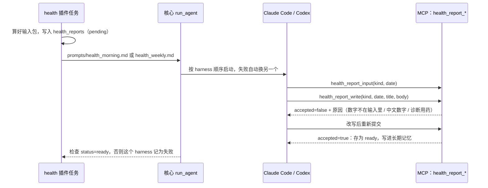

# 健康晨间简报和周报

数字由代码算，模型只负责解读和写成人话。模型输出里的每个数字都必须能在代码给它的数据里找到，否则不收。

## 什么时候生成

| 报告 | 时间 | 说明 |
| --- | --- | --- |
| 晨间简报 `morning` | 每天 04:00–10:45 每 15 分钟检查一次 | 当晚的睡眠记录已经上传（`sleep_sessions` 里有当天质量为 ok 的一晚）就生成；到 10:00 还没有，也照样生成，简报里会写「没有睡眠数据」 |
| 周报 `weekly` | 每周日 21:00 | 总结截至当天的 7 天，并和前 7 天对比 |

都可以在 health 插件配置的 `reports` 里改：`morning_earliest_hour`、`morning_deadline_hour`、`weekly_weekday`、`weekly_hour`、`enabled`。小时数按插件的 `timezone` 判断「今天」，按核心设置的时区排定时任务，两者默认都是 Asia/Shanghai，请保持一致。

已经生成成功的不会重复生成。每份报告最多生成 `max_attempts` 次（默认 2）；每次生成里，核心会按设置的顺序先后尝试 Claude Code 和 Codex。全部失败后报告标为 `failed`，当天不再自动重试，避免持续消耗额度。

## 给模型的数据（health_report_input）

只有按天汇总的数字，没有原始采样、设备来源名称或个人信息：

- 晨间：`daily`（昨天和今天，含每天的综合准备度 `readiness` 和用于判断的 HRV 指标 `hrv_preferred`）、`sleep`（近 7 晚）、`baselines`，也就是三个 `health_get_*` 工具对同一日期返回的内容；`display` 里有代码换算好的写法，例如睡眠时长「7小时40分」（整个睡眠日的总睡眠，含小睡；有小睡时另有主睡眠 `last_night_main_sleep` 和小睡 `last_night_naps`），以及和 30 天基线相比多或少多少。
- 周报：`week` 包含本周和上周各项指标的平均值、最小值、最大值、有数据的天数和变化量（`change`），睡眠时长和变化量的「x小时y分」写法，平均入睡和醒来时刻，睡眠规律性，训练次数、时长和 TRIMP，综合准备度的周平均和变化（`readiness`），以及本周出现过的预警；HRV 的 SDNN 和 RMSSD 分别求周平均（没有 RMSSD 的周不列 RMSSD）。另外还有 `baselines`。
- `goals`：长期记忆里的训练目标笔记（默认 `健康/训练目标.md`，配置项 `goals_path`），没有就是空。

这个输入包在任务开始时算好并存进 `health_reports.input_json`，之后的校验都以它为准。

## 校验（health_report_write）

满足下面三条才接受，否则返回 `accepted=false` 和具体原因，让模型改写。最多被拒 `max_rejections` 次（默认 5）：

1. **数字必须来自输入**：先识别正文里的日期（`10月12日`、`2026-10-12`、`2026年10月12日`）和时刻（`23:20`），它们只能和输入里的日期、时刻比对；其余数字只能和输入里的数值比对，可以四舍五入到更少的小数位（57.65 写成 57.7），但不能自己换算、相加、求差或估算。所以 `12%` 不会因为输入里有「12 日」就被放过。千分位逗号和全角数字会先规范化。正负号看作文字表达（「低 2.25」），按绝对值比对。
2. **不许用中文数字写数量**（「三天」「七个半小时」「十分钟」），以免绕开第 1 条。单独一个「一」（「这一周」「一次」）不算。
3. **不许出现诊断或用药措辞**：确诊、诊断为、患有、疑似、服用、用药、药物、剂量、处方、吃药。提示词也要求只描述数据和趋势，有预警时写「建议关注」，持续异常时可以建议就医。

接受后：状态改为 `ready`，同时写进长期记忆（`健康/晨间简报/<日期>.md`、`健康/周报/<日期>.md`），在 App 里显示为 `text` 卡片（health 插件的 cards，也会出现在 `/api/v1/today`），排在指标卡片后面（指标卡片见 [api.md](api.md) 的「health 插件的卡片」）。

## 接口

- `GET /api/v1/health/reports?date=&kind=&status=`：见 [api.md](api.md)。
- MCP：`health_report_input`、`health_report_write`（health 插件启用后提供），参数放在 `arguments` 对象里。

## 局限

- 校验能保证「没有输入里没有的数字」，不能保证解读本身正确（比如把「低于基线」说成「高于基线」）。这需要人工抽查，或者以后加一个基于规则的方向一致性检查。
- 窗口长度、日期这类小整数总会出现在输入里（比如 7、30），所以「7」「30」这样的数字总能通过校验。
- 测试用的是模拟的模型输出（`tests/test_health_reports.py`），还没有用真实的 Claude Code / Codex 跑过。
