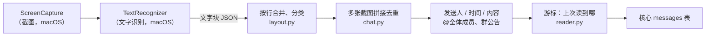

# QQ / 微信截图读取：与平台无关的部分

Windows 原生后端的安装、差别和校准见 [Windows 说明](windows.md)。

`qq_screen` 和 `wechat_screen` 共用 `backend/plugins/screen/`。只有两件事必须在 macOS 上做：**截图**和 **Apple Vision 文字识别**。它们被定义成两个接口，其余逻辑都是普通 Python，在 Linux/WSL 上用假实现测试。



## 两个接口

| 接口 | 方法 | macOS 实现 | Linux 假实现 |
| --- | --- | --- | --- |
| `ScreenCapture` | `preview()`：只截会话列表，不点开聊天<br>`capture_chat(chat, page)`：page 0 切到该会话并滚到最新；page n 在上一屏基础上向上滚一步，保留部分重叠<br>`capture_announcement(chat)`：打开群公告、截图、关闭 | `HelperScreenCapture`（本机 helper） | `FakeScreenCapture` |
| `TextRecognizer` | `recognize(screenshot) -> [TextBlock]` | `HelperTextRecognizer`（Apple Vision） | `FakeTextRecognizer` |

截图接口里没有输入、发送、点击这类方法。helper 协议只接受 `preview`、`capture_chat`、`capture_announcement`、`capture_page`、`recognize` 五个动作，其他动作在发出前就会被拒绝。截图文件只留在本机，进入核心的只有识别出的文字和本地路径。

## macOS 上的 helper

`HelperScreenCapture` 和 `HelperTextRecognizer` 调用 `backend/helpers/screen-helper`。每次请求都带上 `app`（qq / wechat）和截图目录 `out_dir`（插件数据目录下的 `screens/<插件>/`）。

- **截图**：用 ScreenCaptureKit 截 App 的主窗口（同一个 App 面积最大的普通窗口）。窗口被别的窗口挡住也能截，但不能最小化或关掉；预览模式只截图，不碰 App。
- **找区域**：不靠坐标常数，而是找窗口自己的分隔线：沿着大部分高度颜色都在变的竖线，和沿着聊天栏大部分宽度颜色都在变的横线。文字、头像不会这样。依次得到导航栏、会话列表、聊天区；聊天区右边的群成员面板单独切掉（否则里面的名字会被当成自己发的消息）；顶部最后一条横线以上是标题栏和会话标题，最后一条靠下的横线以下是输入框。找不到时用默认比例（导航栏 6%、列表到 32%、标题到 9%、输入框从 74%）。
- **capture_page**（课表插件用，`app` 为 chrome）：截下标题含请求里 `title` 的那个 Chrome 窗口（浏览器窗口的标题就是当前标签页的标题），只截图，不激活、不点击、不滚动，也只要屏幕录制权限。找不到这样的窗口时报 `screen_page_not_open`。聊天的三个动作不接受 chrome，capture_page 也不接受聊天 App。见 [timetable.md](timetable.md)。
- **识别**：Apple Vision（`VNRecognizeTextRequest`，简体中文和英文，精确模式），只识别它自己写进 `out_dir` 的 PNG。
- **capture_chat**：先激活 App，用 OCR 读会话标题；不是要读的会话时，在会话列表里用 OCR 找到这个名字（名字太长被截成「…」也认），点一下这一行，再核对标题：标题栏里要有一行正好是这个名字（后面的成员数如「(56)」除外），「软件1班家长群」不算「软件1班」。返回的 `chat` 是标题栏里读到的名字，后端再核对一次。page 0 滚到最底，之后每页向上滚聊天区高度的 65%，留三分之一重叠。每张截图前都核对标题，对不上就报 `screen_chat_not_open`，不会读错会话。滚动后画面和上一页一样时报 `at_top`。
- **群公告**：还没校准打开公告面板的操作，`capture_announcement` 现在总是返回没有公告。
- **出错**：非零退出，stdout 是 `{"error": "screen_…"}`，例如 `screen_app_not_running`、`screen_window_not_found`、`screen_recording_denied`、`screen_accessibility_denied`、`screen_chat_not_in_list`。
- 另外有三个只在设置和校准时手动用的动作，Python 不会发：`authorize`（向系统申请两项权限）、`permissions`（只查不申请）、`layout`（返回找到的区域；带 `out_dir` 时把三块区域另存成 PNG，供 `recognize` 检查）。

在 Mac mini 上用 QQ 7.0.2 校准过：四条分隔线和成员面板都找得到，会话列表的名字、时间和预览行按上面的规则解析。发现并处理了两点：QQ 7 把较早的时间写成「昨天20:59」（中间没有空格），以及免打扰之类的小图标会被识别成一个孤立的字，现在都按徽标处理。

## 文字块 JSON（OCR 输出格式）

```json
{"text": "@全体成员 周五前交实验报告", "x": 0.105, "y": 0.0755, "w": 0.504, "h": 0.016, "confidence": 0.97}
```

- 坐标是截图区域（聊天区或会话列表）的比例，**原点在左上角**。Apple Vision 的 `boundingBox` 原点在左下角，helper 要换算：`y = 1 - vision_y - vision_h`。
- 一行文字可能被识别成多个块，解析时按行合并。
- 假实现的输入文档格式见 `plugins/screen/fake.py`；完整示例是 `backend/tests/fixtures/screen/qq_group_one_screen.json`（合成数据）。

## 解析规则（`layout.py`、`chat.py`）

1. **合并成行**：纵向重叠一半以上的块算同一行，从左到右拼接，间距大时补一个空格。贴着截图上下边缘的行是被截断的，整行丢弃。
2. **按位置分类**：
   - 左边（起点 x ≤ 0.2）：对方的发送人名字或消息气泡；
   - 右边（终点 x ≥ 0.84）：自己发的消息，发送人记为「我」；
   - 居中：符合时间格式的是**时间分隔**，其他是**系统提示**（撤回、入群、"发布了新的群公告"等）。
3. **名字和正文**：名字的字号比正文小，而且紧挨头像，在所有小字里最靠左；气泡里的字有内边距，会往右缩进。拼接完所有截图后先这样找出名字所在的列，再用缩进的行（加上右侧的行）算行高的上四分位数，作为正文行高；矮于它 0.85 倍、又在名字列上的行才是名字。只看缩进的行，是因为一段只有几条消息的聊天里名字和卡片行可能占了大半，全部一起算会把正文行高估低。不按单张截图来算，避免同一行在两张图里被分成不同类别。名字前的「群主」「管理员」「LV12」等头衔会被去掉。鼠标停在某条消息上时，QQ 会在名字后面显示发送时间（如「10-27 09:22:50」）：带这种时间的行也算名字，时间不进发送人，OCR 给它画的框差不多和正文一样高也没关系。
4. **气泡边界**：同侧相邻两行的间距小于 0.8 个正文行高就属于同一个气泡，否则是新消息。字号和名字一样小、但比名字列缩进的行是卡片里的字（比如 QQ 作业卡片的「名称 类型 时间」表格），行距再大也留在上面那条消息里。群聊里没有名字的新气泡沿用上一个发送人；单聊（整段没有名字行）里左边的消息都记为对方，发送人就是会话名。
5. **时间**：每条消息取它上方最近的时间分隔。支持 `20:15`、`昨天 08:30`、`前天 …`、`星期一 09:00`、`周四 …`、`10月12日 08:30`、`2025年10月12日 …`、`2025/10/12 …`、`上午/下午/晚上/凌晨/中午 3:05`，都相对截图时刻、按设置的时区换算。标签比截图时刻还晚、日期不存在等情况一律不解析。**上方没有时间分隔的消息不产生 ID、不入库**，读取器会继续往上滚，绝不编造时间。
6. **占位符**：`[图片]`、`[表情]`、`[语音]`、`[文件]` 等由 helper 在识别到非文字气泡时输出，按普通正文保留。
7. **@全体成员 / @所有人**：消息含 QQ 的 `@全体成员` 或微信的 `@所有人` 时标为优先（`priority=true`），提炼时排在前面。
8. **群公告**：系统提示或气泡以「群公告」开头时，读取器调用 `capture_announcement` 读全文，生成一条发送人为「群公告」、正文以「【群公告】」开头的优先消息。已经处理过的公告提示记在游标里，下次不会重复打开。

## 多张截图的拼接和去重

从最新一屏开始，每次向上滚一步截一张，相邻两张必须有重叠。拼接按行进行：较旧那张底部的若干行，要和已拼好时间线顶部的若干行逐行相同（分类、去掉空格和标点后的文字都一致），而且这些行在两张图里的纵向位移必须一致（误差 1% 屏高以内）。这样，碰巧文字相同但位置对不上的行不会被当成重叠。

- 长消息被屏幕边缘切成两半时，拼接后再组装消息，得到的就是完整的一条。
- 重叠区的行只保留一份，所以同一条消息不会出现两次。
- 两张图完全没有共同的行时报 `screen_history_gap`。这说明滚得太多，中间可能漏了消息。
- 向上滚动后画面没有变化（或 helper 报告 `at_top`）时，视为到达历史开头。

## 消息 ID 和游标

- `external_id = <app>:sha256(app, 会话, 发送人, 分钟, 规范化正文, 同一时间块内的第几条相同消息)`。OCR 的空格、标点、全半角差异不影响 ID。同一分钟、同一人连发三次「收到」会得到三个不同的 ID；重复读取得到相同的 ID，核心按 `(plugin, external_id)` 去重，所以重读不会产生重复消息。
- 每个会话的游标是 `{anchor: 最新一条的 ID, sent_at, hints}`，只在核心把整批消息写进数据库之后（`commit_fetch`）才更新。
- 下次读取时从最新一屏往上滚，直到找回 anchor，返回它之后的消息。如果 anchor 找不到了（比如那条消息被撤回），滚过它所在的那一分钟就停下，从那一分钟开始重新读；已入库的消息靠 ID 去重。
- 第一次读某个会话时没有游标，只读 `initial_pages` 屏（默认 2）。
- `max_pages` 屏之内接不上游标就报 `screen_history_gap`，游标保持不变，下次再试，不会悄悄跳过消息。

## 仅预览模式（默认）

`preview_only=true` 且 `open_on_demand=[]`（默认）时只截会话列表，不点开聊天，所以不会把消息标为已读。每个会话取「名字 + 右侧时间 + 下一行预览」，只保留白名单里**时间是今天具体时刻**（如 `20:41`）的那一条。「昨天」「星期一」这类旧预览平时在当天已经读过，会跳过。会话列表上的未读数会被去掉；`[有人@我]`、`[@全体成员]` 标记会让消息优先；`[草稿]` 是自己没发出的草稿，跳过。预览文字会被 App 截断，完整内容可关闭预览模式读取，或为个别群授权下述按需读取。

**补读中断的那几天。** QQ 没开、屏幕锁着时读取会失败，那天群里最后一条消息第二天起在列表上只剩「昨天」「星期二」，原来就再也读不到。现在一个白名单群的那一行是最近一周内的旧日期，而记忆中心里这个群从那天起一条也没有时，就算漏读了：

- 时间还带分钟（「昨天20:59」）：照今天的预览入库，时间就是这个。
- 只剩日期（「星期二」）：不编时间。群在 `open_on_demand` 里就按需点开一次（原因 `missed`），读到的消息带真实时间；同一行只点开一次，仍受每日上限约束。
- 只剩日期、又不能点开（或点开过还是没读到）：不入库，看门狗在 App 里提醒「有群的消息没读到」，列出群名，请用户自己去看一眼，或允许按需点开这个群。
- 更早的日期（「10/12」）不补。

**群名只认完整的。** 和白名单比较时忽略全半角、大小写、空格和标点，但必须是整个名字。会话列表把太长的群名截成「人工智能学院2026级计算…」时不读：白名单外的群（比如同一个班的家长群、隔壁班的群）截断后可能一模一样，列表上分不出来。这样的名字只要可能是白名单里的群，就列在插件卡片「群名被截断，没有读」里，把 App 左边的会话栏拉宽、让完整群名显示出来就能读到。

预览照样入库，但带 `preview` 标记，Agent 读到的 note 是「预览，内容可能被截断」：

- **提炼规则**（写在 `prompts/extract_todos.md`）：只有要做的事和截止时间都完整可见、意思明确时才建立待办（备注里写「来自预览，内容可能不完整」），其余只进摘要。
- **用完整内容替换**：之后（关闭预览模式、点开聊天）读到同一条消息时，核心把预览那一行改成完整内容，消息 ID 不变，引用它的待办仍然有效。判断「同一条」的条件：同一插件、同一会话；去掉「发送人：」前缀、空格、标点和末尾省略号后，完整正文以预览文字开头（至少 2 个字）；完整消息的时间在预览时间之前 10 分钟到之后 1 分钟之间（聊天里的时间分隔只标出一段消息的开始时间）。
- 替换前如果 Agent 已经处理过这条预览，消息会重新变成未处理，并带 `revised` 标记（note「之前按预览处理过，现在是完整内容」）。Agent 先找引用这条消息的待办并按完整内容修正，没有的再重新判断，不重复新增。
- 先读到完整消息、后读到它的预览时，预览直接丢弃。
- 已知限制：OCR 把预览或正文开头认错时匹配不上，两条都会保留（宁可重复也不漏）；待办靠去重合并。

## 名单、接龙、本人承诺与按需读取

QQ 和微信共用 `ScreenPlugin` 的配置和读取逻辑：

| 配置 | 默认值 | 含义 |
| --- | --- | --- |
| `self_names` | `[]` | 姓名、完整学号、常用群昵称的字符串数组；只在本机代码匹配，不交给模型。未配置时不判断“有我/没我” |
| `open_on_demand` | `[]` | 允许按需点开的群名数组，必须是 `whitelist` 的子集；空数组关闭此功能 |
| `on_demand_pages` | `2` | 一次按需读取最多几屏（1–20）；复用完整读取和游标。这几屏接不上上次读到的位置时，只收下看得到的这几屏，不推进游标，留给以后的完整读取补上 |
| `park_chat` | 不填 | 按需读取以后切到的会话，必须在 `whitelist` 里，比如一个很少有人说话的群；不填时刚点开的群一直开着 |
| `max_opens_per_chat_per_day` | `4` | 每群每天的点开上限（0–100，0 禁止点开），按配置时区的本地日期计数，跨重启保留；helper 还没点任何东西就失败的（没有屏幕录制或辅助功能权限、QQ 没开）不算次数 |

**点开会把这个群标为已读，已读状态会同步到手机，手机上的群红点也会消失。** `open_on_demand` 是用户为少数群接受这个代价的授权；普通白名单并不意味着允许按需点开。

本机 `core/message_signals.py` 对预览、完整聊天和已读到的群公告做统一判断：有“未交、未完成、未提交、没交、未填、未报名、未签到、以下同学、名单”等关键词且命中本人身份，产生 `self_listed`；汉字间容忍 OCR 空格，学号按完整数字串匹配。含接龙标记和编号列表时，只在列表条目中判断本人：有则 `self_joined`，无则 `self_missing`。空配置不产生这些判断；它仍是 OCR 文字规则，不能识别图片附件或保证名单完整。

结果以 JSON 数组 `messages.flags` 入库；`self_listed` / `self_missing` 的 `priority=2`，高于普通 @全体或公告的 1。重读合并 flags，预览被全文替换时也保留；`self_joined` 与历史 `self_missing` 同时存在时，提炼以已参加为准。首次发现任一紧急 flag，整批入库成功后立即用 `jobs.submit("extract_todos", rerun=True)` 提交提炼；运行中则合并为结束后的一次追加运行。同一消息之后不会再因紧急 flag 重复触发；新 flag 也会把已处理消息恢复为未处理。

预览里出现名单/接龙/报名/收集表线索且以省略号结束，或缺少足够的成员信息；或带 `[@全体成员]` / `[@所有人]`，才自动请求打开该群。完整可判断的名单预览不点开。只打开授权群，仍按完整群名匹配、屏幕锁、逐屏标题核对和原游标读取；标题不符报 `screen_chat_mismatch`。相同预览成功入库后不再自动打开；新线索仍受每日上限约束。

Agent 可调用 `screen_open_chat(plugin, chat_name)`，plugin 仅接受 `qq_screen` / `wechat_screen`。它只把一个授权群放进持久请求队列，并立即排该插件的读取任务（正在抓取时合并为后续一次）；没有可用任务时留到下一轮。重复请求同一个待执行群合并。执行时重新核对当前配置和每日余额；权限被撤回不会打开。返回 `scheduled` /「已安排」表示请求已入队，不表示全文已到达。`denied` 的原因包括 `screen_plugin_not_allowed`、`plugin_disabled`、`screen_open_not_allowed`、`screen_open_daily_limit`。

次数在第 0 屏动作前持久化，标题核对/OCR/入库失败也占一次，避免反复清红点；第 0 屏还没点任何东西就失败的（没有屏幕录制或辅助功能权限、QQ 没开）退回这一次。每次尝试在 runs 的 job 中记 `plugin:<id>:screen_open:<群名哈希>:<固定原因>:<当日次数>`，错误仅记固定代码，不记聊天、姓名、学号或群名明文。固定原因是 `truncated`、`membership_unknown`、`everyone`、`agent_request`、`missed`。

读完（失败也一样）调用现有 `preview` 再截会话列表，后续恢复列表预览流程。**helper 没有“返回/切换消息列表页面”的动作**；桌面双栏界面的列表一直在，但刚打开的聊天可能仍停在右侧且滚动位置改变。这里不能承诺关闭聊天或恢复原先界面；没有增加 helper 动作、重编译或改动权限。刚点开的群一直开着时，QQ 可能继续把它的新消息标为已读；设了 `park_chat` 就在读完后切到那个会话（它同样会被标为已读，所以选一个不在乎红点的）。按需读取失败（标题对不上、OCR 失败）只记进 runs、占一次次数，这一轮的会话列表预览照常入库。完整模式本来就点开每个群，Agent 的请求直接算已满足。

点击始终由固定脚本完成，不交给 Agent computer use：后者可能输入或发送，且把截图交给云端。现有接口只支持会话切换、滚动、打开群公告这些只读操作。截图和身份配置留在本机，MCP 消息仅返回 flags，不返回命中的是哪个身份，并把正文/发送人/会话名中命中配置的内容替换成 `[本人]`；建立待办允许引用这份脱敏片段并在本机验证来源，原始消息不改。MCP 的待办新增、查询、修改返回也对标题、备注、原文片段和来源中的本人身份脱敏，避免来源字段再次暴露名字；本地存储与 App 的来源信息保留原样。

完整聊天的本人气泡保存 `outgoing=true` 并通过 MCP 返回，预览一律 false。提炼会把“我晚上发、好的我来做”等本人承诺建立为待办，别人承诺不算；名单上的待办没写期限时，截止设为 30 分钟后（23:00 到 07:00 之间设为下一个 08:00），让提醒尽快响，并备注“名单上有你”；接龙缺席还需全体/适用范围要求，已参加不建。飞书目前没有可靠的本人身份信息，继续使用默认 false。

## 在 Mac 上校准

`layout` 配置项可以覆盖这些阈值（都是截图区域的比例）：`incoming_max_x`、`outgoing_min_right`、`center_tolerance`、`name_height_ratio`、`name_indent`、`bubble_gap`、`row_overlap`、`edge_margin`、`space_gap`。校准方法：用 helper 的 `layout`（带 `out_dir`）截出三块区域，再用 `recognize` 输出块，存成上面的 JSON（**只在本机，不要提交真实聊天**），用假实现跑 `ChatScreenReader`，看发送人和气泡是否切分正确，然后调整阈值。需要别人帮忙看时只给几何信息：位置、字数和打码后的文字。

## 已知限制

- 点开会话和滚动（关闭预览模式时）还没有在真实的白名单会话上校准；群公告还不会读。
- 刚过午夜时，会话列表里还写着前一天的「23:13」这类时刻，比截图时间晚，按规则不解析；这几条预览会跳过，等聊天打开读完整内容时再补。
- QQ / 微信界面改版后，几何阈值可能需要重新校准。
- 如果同一分钟内两条相同的消息中前一条被撤回，后一条的序号会变，可能被当成已读过而漏掉。
- 消息里的 OCR 错字会让 ID 变化，导致同一条消息入库两次。目前以「不漏」优先。
- 预览模式依赖会话列表的「名字 + 时间」行结构；置顶、免打扰图标等布局细节要在 Mac 上核对。
