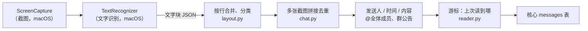

# QQ / 微信截图读取：与平台无关的部分

Windows 原生后端的安装、差别和校准见 [Windows 说明](windows.md)。

`qq_screen` 和 `wechat_screen` 共用 `backend/plugins/screen/`。只有两件事必须在 macOS 上做：**截图**和 **Apple Vision 文字识别**。它们被定义成两个接口，其余逻辑都是普通 Python，在 Linux/WSL 上用假实现测试。



## 两个接口

| 接口 | 方法 | macOS 实现 | Linux 假实现 |
| --- | --- | --- | --- |
| `ScreenCapture` | `preview()`：只截会话列表，不点开聊天<br>`capture_chat(chat, page)`：page 0 切到该会话并滚到最新；page n 在上一屏基础上向上滚一步，保留部分重叠<br>`capture_announcement(chat)`：打开群公告、截图、关闭 | `HelperScreenCapture`（本机 helper） | `FakeScreenCapture` |
| `TextRecognizer` | `recognize(screenshot) -> [TextBlock]` | `HelperTextRecognizer`（Apple Vision） | `FakeTextRecognizer` |

截图接口里没有输入、发送、点击这类方法。helper 协议只接受 `preview`、`capture_chat`、`capture_announcement`、`capture_page`、`recognize` 五个动作，其他动作在发出前就会被拒绝。截图文件只留在本机，进入核心的只有识别出的文字和本地路径。

## macOS 上的 helper

`HelperScreenCapture` 和 `HelperTextRecognizer` 调用 `backend/helpers/screen-helper`。每次请求都带上 `app`（qq / wechat）和截图目录 `out_dir`（插件数据目录下的 `screens/<插件>/`）。

- **截图**：用 ScreenCaptureKit 截 App 的主窗口（同一个 App 面积最大的普通窗口）。窗口被别的窗口挡住也能截，但不能最小化或关掉；预览模式只截图，不碰 App。
- **找区域**：不靠坐标常数，而是找窗口自己的分隔线：沿着大部分高度颜色都在变的竖线，和沿着聊天栏大部分宽度颜色都在变的横线。文字、头像不会这样。依次得到导航栏、会话列表、聊天区；聊天区右边的群成员面板单独切掉（否则里面的名字会被当成自己发的消息）；顶部最后一条横线以上是标题栏和会话标题，最后一条靠下的横线以下是输入框。找不到时用默认比例（导航栏 6%、列表到 32%、标题到 9%、输入框从 74%）。
- **capture_page**（课表插件用，`app` 为 chrome）：截下标题含请求里 `title` 的那个 Chrome 窗口（浏览器窗口的标题就是当前标签页的标题），只截图，不激活、不点击、不滚动，也只要屏幕录制权限。找不到这样的窗口时报 `screen_page_not_open`。聊天的三个动作不接受 chrome，capture_page 也不接受聊天 App。见 [timetable.md](timetable.md)。
- **识别**：Apple Vision（`VNRecognizeTextRequest`，简体中文和英文，精确模式），只识别它自己写进 `out_dir` 的 PNG。
- **capture_chat**：先激活 App，在会话列表里用 OCR 找完整名称，且同一行必须有右侧时间栏；同一行被 Vision 拆成多个名字块时先合并。当前视口找不到时，仅滚动会话列表：先向上最多 12 步，再向下最多 24 步，每步约列表高度的 65%；视口的文字与位置不变就停止该方向，整个查找最多 36 步。不输入、不使用搜索框。截断名称、短前缀、预览正文中的同名文字都不点击。可见列表中有多个同名候选时报 `screen_chat_ambiguous`，还没点击就停止；即使当前聊天标题已匹配，第 0 页也要先通过列表检查。不是当前会话时点这一行，再核对标题：标题栏里要有一行正好是这个名字（后面的成员数如「(56)」除外），「软件1班家长群」不算「软件1班」。返回的 `chat` 是标题栏里读到的名字，后端再核对一次。page 0 向下滚 6000 点，之后每页向上滚聊天区高度的 65%，留三分之一重叠。每张截图前都核对标题，对不上就报 `screen_chat_not_open`。滚动后画面和上一页一样时报 `at_top`。
- **群公告**：还没校准打开公告面板的操作，`capture_announcement` 现在总是返回没有公告。
- **出错**：非零退出，stdout 是 `{"error": "screen_…"}`，例如 `screen_app_not_running`、`screen_window_not_found`、`screen_recording_denied`、`screen_accessibility_denied`、`screen_chat_not_in_list`。
- Python 在截图动作前检查当前用户的控制台会话与显示器状态；无法使用桌面时不启动助手。Swift 每次点击或滚动前还核对前台 App、窗口 ID、原窗口位置和操作点最上层窗口，窗口被遮挡、移动时停止并报 `screen_window_obscured`。识别已保存的图片不需要桌面可用。聊天截图没有可用文字行时报 `screen_empty_capture`，没有可解析时间/发送人的消息时报 `screen_no_messages`；均不猜测消息时间。
- 会话名比较只做完整名字规范化：全半角、大小写、空格、标点、装饰符号和表情的连接符/变体选择符不计；不做前缀、编辑距离或汉字错字推断。Swift 和 Python 使用同一边界。标题允许尾随成员数，优先匹配包含括号数字的原配置全名；任意截断、省略号均拒绝。
- 另外有三个只在设置和校准时手动用的动作，Python 不会发：`authorize`（向系统申请两项权限）、`permissions`（只查不申请）、`layout`（返回找到的区域；带 `out_dir` 时把三块区域另存成 PNG，供 `recognize` 检查）。

在 Mac mini 上用 QQ 7.0.2 校准过：四条分隔线和成员面板都找得到，会话列表的名字、时间和预览行按上面的规则解析。发现并处理了两点：QQ 7 把较早的时间写成「昨天20:59」（中间没有空格），以及免打扰之类的小图标会被识别成一个孤立的字，现在都按徽标处理。

## 文字块 JSON（OCR 输出格式）

```json
{"text": "@全体成员 周五前交实验报告", "x": 0.105, "y": 0.0755, "w": 0.504, "h": 0.016, "confidence": 0.97}
```

- 坐标是截图区域（聊天区或会话列表）的比例，**原点在左上角**。Apple Vision 的 `boundingBox` 原点在左下角，helper 要换算：`y = 1 - vision_y - vision_h`。
- 一行文字可能被识别成多个块，解析时按行合并。
- 假实现的输入文档格式见 `plugins/screen/fake.py`；完整示例是 `backend/tests/fixtures/screen/qq_group_one_screen.json`（合成数据）。

## 解析规则（`layout.py`、`chat.py`）

1. **合并成行**：纵向重叠一半以上的块算同一行，从左到右拼接，间距大时补一个空格。贴着截图上下边缘的行是被截断的，整行丢弃。
2. **按位置分类**：
   - 左边（起点 x ≤ 0.2）：对方的发送人名字或消息气泡；
   - 右边（终点 x ≥ 0.84）：自己发的消息，发送人记为「我」；
   - 居中：符合时间格式的是**时间分隔**，其他是**系统提示**（撤回、入群、"发布了新的群公告"等）。
3. **名字和正文**：名字的字号比正文小，而且紧挨头像，在所有小字里最靠左；气泡里的字有内边距，会往右缩进。拼接完所有截图后先这样找出名字所在的列，再用缩进的行（加上右侧的行）算行高的上四分位数，作为正文行高；矮于它 0.85 倍、又在名字列上的行才是名字。只看缩进的行，是因为一段只有几条消息的聊天里名字和卡片行可能占了大半，全部一起算会把正文行高估低。不按单张截图来算，避免同一行在两张图里被分成不同类别。名字前的「群主」「管理员」「LV12」等头衔会被去掉。鼠标停在某条消息上时，QQ 会在名字后面显示发送时间（如「10-27 09:22:50」）：带这种时间的行也算名字，时间不进发送人，OCR 给它画的框差不多和正文一样高也没关系。
4. **气泡边界**：同侧相邻两行的间距小于 0.8 个正文行高就属于同一个气泡，否则是新消息。字号和名字一样小、但比名字列缩进的行是卡片里的字（比如 QQ 作业卡片的「名称 类型 时间」表格），行距再大也留在上面那条消息里。群聊里没有名字的新气泡沿用上一个发送人；单聊（整段没有名字行）里左边的消息都记为对方，发送人就是会话名。
5. **时间**：每条消息取它上方最近的时间分隔。支持 `20:15`、`昨天 08:30`、`前天 …`、`星期一 09:00`、`周四 …`、`10月12日 08:30`、`2025年10月12日 …`、`2025/10/12 …`、`上午/下午/晚上/凌晨/中午 3:05`，都相对截图时刻、按设置的时区换算。标签比截图时刻还晚、日期不存在等情况一律不解析。**上方没有时间分隔的消息不产生 ID、不入库**，读取器会继续往上滚，绝不编造时间。
6. **占位符**：`[图片]`、`[表情]`、`[语音]`、`[文件]` 等由 helper 在识别到非文字气泡时输出，按普通正文保留。
7. **@全体成员 / @所有人**：消息含 QQ 的 `@全体成员` 或微信的 `@所有人` 时标为优先（`priority=true`），提炼时排在前面。
8. **群公告**：系统提示或气泡以「群公告」开头时，读取器调用 `capture_announcement`，核对返回的完整会话名后才识别公告正文，生成一条发送人为「群公告」、正文以「【群公告】」开头的优先消息。已经处理过的公告提示记在游标里，下次不会重复打开。

## 多张截图的拼接和去重

从最新一屏开始，每次向上滚一步截一张，相邻两张必须有重叠。拼接按行进行：较旧那张底部的若干行，要和已拼好时间线顶部的若干行逐行相同（分类、去掉空格和标点后的文字都一致），而且这些行在两张图里的纵向位移必须一致（位移的最大差为屏高的 2%）。文字匹配至少需要两种不同的行，并检查位移方向。只有一句或反复几句相同的「收到」时，继续尝试像素比对。翻页跨过午夜，时间分隔按每页截图解析出的实际时刻匹配，例如「23:58」和「昨天23:58」可以指向同一分钟。对齐位置的时间分隔如果解析到不同日期或时刻，记录缺口。

- 长消息被屏幕边缘切成两半时，拼接后再组装消息，得到的就是完整的一条。
- 重叠区的行只保留一份，所以同一条消息不会出现两次。
- 重叠区几乎全是图片或小字卡片（比如一屏作业卡片）时，Vision 每次读出的文字都不一样，可能一行都对不上。这时再比两张截图的像素：在滚动距离附近（误差 0.5% 屏高）找位移，较旧那张里能区分位置的像素行（本屏只出现一次的行，空白行和重复的边框不算），至少 80% 要和较新那张逐字节相同，而且至少 20 行。右侧 5% 是滚动条，不比。截图只在本机读取：PNG 用 macOS 自带的 sips 转成临时 BMP，用完删掉；其他系统上只认 BMP，不做像素比对。2026-11-15 实测，三个 QQ 群断开的那几对截图，在滚动距离处有 95%–100% 的行相同，换别的位移一行都对不上。
- 文字和像素都证明不了重叠时，记录 `screen_history_gap`。不跨缺口拼接，不丢掉此前读到的消息：两边各自有可靠时间和发送人的消息分别保留，没有时间的部分不入库，然后停止此会话的向上读取。
- 后续页标题不符、OCR 失败、空白或助手失败，同样保留此前已确认会话的消息；错误页的正文不入库。单个会话失败不影响其余会话，失去桌面访问则立即停止余下会话及停车/恢复列表动作。
- 只有画面证明没动时，才视为到达历史开头；OCR 没有新增文字行不能证明已到顶部。helper 只在两张截图逐字节相同时报 `at_top`，群里有动图时它看不出来；所以读取程序还会在识别前比较这一页和上一页同一位置的像素行：至少 20 行且半数以上能区分位置的行没变，才可能判为到顶。上、下半屏各自如果有至少 20 行可区分，也必须各有原位匹配，避免固定横幅掩盖下方聊天滚动。满足这些条件才结束翻页，不再拿同一屏去拼接（2026-11-18，acm 群到顶时 77% 的行没变，前 20 页每页都是 0）。
- helper 对截图的全部灰度像素和尺寸计算指纹，避免稀疏文字落在采样点之间、或窗口尺寸变化时，误判为没有滚动。

## 消息 ID 和游标

- `external_id = <app>:sha256(app, 会话, 发送人, 分钟, 规范化正文, 同一时间块内的第几条相同消息)`。OCR 的空格、标点、全半角差异不影响 ID。同一分钟、同一人连发三次「收到」会得到三个不同的 ID；重复读取得到相同的 ID，核心按 `(plugin, external_id)` 去重，所以重读不会产生重复消息。
- 每个会话的游标是 `{anchor: 最新一条的 ID, sent_at, hints}`，只在核心把整批消息写进数据库之后（`commit_fetch`）才更新。
- 下次读取时从最新一屏往上滚，直到找回 anchor，返回它之后的消息。如果 anchor 找不到了（比如那条消息被撤回），滚过它所在的那一分钟就停下，从那一分钟开始重新读；已入库的消息靠 ID 去重。
- 第一次读某个会话时没有游标，读配置的 `initial_pages` 屏（默认 2）或读到顶部。覆盖范围里有时间分隔但 OCR 无法解析、或有消息无法确定发送人时，保存可解析的全文，保留缺口和原游标。整屏最新消息仍早于已有游标时也保留缺口，避免把游标改成更早的消息。
- `max_pages` 或 `on_demand_pages` 屏之内接不上游标时，保留能解析的消息，并记录 `screen_history_gap`；游标保持不变，不会悄悄宣称中间已经覆盖。缺口写在本地 `screen_gap:<会话>`，只有后续连续读完并成功入库才清除。部分读取不会把本次预览线索或 Agent 请求标为完成；按需缺口保留固定触发原因，受退避和配额约束继续补读，避免部分消息入库后旧日期预览被误判为已补完。
- 完整模式也逐会话隔离失败：返回读到的消息一起入库，每个成功会话单独提交游标；全部失败且没有消息时仍向调度器抛固定错误码。预览模式保留会话列表消息，按需点开失败不覆盖它们。停车或恢复列表失败也不再丢弃已读消息。

## 仅预览模式（默认）

`preview_only=true` 且 `open_on_demand=[]`（默认）时只截会话列表，不点开聊天，所以不会把消息标为已读。每个会话取「名字 + 右侧时间 + 下一行预览」，只保留白名单里**时间是今天具体时刻**（如 `20:41`）的那一条。「昨天」「星期一」这类旧预览平时在当天已经读过，会跳过。会话列表上的未读数会被去掉（Vision 读不出灰色或红色小圆角里的白字，按需读取时改看像素，见下）；`[有人@我]`、`[@全体成员]` 标记会让消息优先；`[草稿]` 是自己没发出的草稿，跳过。`[文件]`、`[图片]` 和正文自带的方括号标题保留。重名检查包括所有已识别的会话标题，含草稿行及正文被裁掉的行。预览文字会被 App 截断，完整内容可关闭预览模式读取，或为个别群授权下述按需读取。

**补读中断的那几天。** QQ 没开、屏幕锁着时读取会失败，那天群里最后一条消息第二天起在列表上只剩「昨天」「星期二」，原来就再也读不到。现在一个白名单群的那一行是最近一周内的旧日期，而记忆中心里这个群从那天起一条也没有时，就算漏读了：

- 时间还带分钟（「昨天20:59」）：照今天的预览入库，时间就是这个。
- 只剩日期（「星期二」）：不编时间。群在 `open_on_demand` 里就按需点开一次（原因 `missed`），读到的消息带真实时间；完整补读成功后不再为同一行点开，失败/部分补读仍受每日上限和独立退避约束。
- 只剩日期、又不能点开（或点开过还是没读到）：不入库，看门狗在 App 里提醒「有群的消息没读到」，列出群名，请用户自己去看一眼，或允许按需点开这个群。
- 更早的日期（「10/12」）不补。

**有未读角标就点开。** 预览只显示最新一条，一个群半小时里说了好几句，中间的就读不到。`open_on_demand` 里的群在会话列表上有未读角标时（`open_on_unread`，默认开），按需点开读到上次读过的位置（原因 `unread`）。角标的数字 Vision 读不出来，读取程序看这一行预览右边的像素：有一块实心的同色圆角（免打扰的群是灰色，其他是红色）就算有未读；免打扰铃铛和预览文字都是细线条，不会被当成角标。这台 Mac 上 8 张列表截图里，角标每次都认出来，没有角标的行一次也没误认；2026-11-19 又用最近 40 张列表（869 行、114 个角标）核对过，预览被截成「…」、角标紧挨文字的灰色 1、9、99+ 也都认出来了。这个判断只在 Retina（2 倍）截图上核对过。只要看到角标，即使预览日期已读、或最近两次的文字和分钟完全相同，仍可触发读取。点开以后角标消失，下次只有又来了新消息才会再点开。这类点开有自己的每日上限 `max_unread_opens_per_chat_per_day`，不占「@全体成员」和 Agent 请求用的 `max_opens_per_chat_per_day`；同时命中两类原因时优先用可用的普通额度，普通额度用完也可以用角标额度满足同一个请求，一轮只打开一次。

**群名只认完整的。** 和白名单比较时忽略全半角、大小写、空格和标点，但必须是整个名字。会话列表把太长的群名截成「信息学院2026级软件…」时不读：白名单外的群（比如同一个班的家长群、隔壁班的群）截断后可能一模一样，列表上分不出来。中间出现省略号也按截断处理。这样的名字只要可能是白名单里的群，就列在插件卡片「群名被截断，没有读」里，把 App 左边的会话栏拉宽、让完整群名显示出来就能读到。

白名单里有两个名称规范化后相同的配置会报 `screen_whitelist_ambiguous`，须先修正。可见列表里有两个名称规范化后相同的会话时，两者的预览都跳过，也不执行该名称的按需打开请求；卡片和看门狗提示「同名会话，没有读」。请先设置不同的会话名称并更新白名单。只按名称读取无法区分列表外的同名会话，所以白名单名称仍需在整个账号内唯一。

预览照样入库，但带 `preview` 标记，Agent 读到的 note 是「预览，内容可能被截断」：

- **提炼规则**（写在 `prompts/extract_todos.md`）：只有要做的事和截止时间都完整可见、意思明确时才建立待办（备注里写「来自预览，内容可能不完整」），其余只进摘要。
- **用完整内容替换**：之后（关闭预览模式、点开聊天）读到同一条消息时，核心把预览那一行改成完整内容，消息 ID 不变，引用它的待办仍然有效。判断「同一条」的条件：同一插件、同一会话；去掉「发送人：」前缀、空格、标点和末尾省略号后，完整正文以预览文字开头（至少 2 个字）；完整消息的时间在预览时间之前 10 分钟到之后 1 分钟之间（聊天里的时间分隔只标出一段消息的开始时间）。
- 替换前如果 Agent 已经处理过这条预览，消息会重新变成未处理，并带 `revised` 标记（note「之前按预览处理过，现在是完整内容」）。Agent 先找引用这条消息的待办并按完整内容修正，没有的再重新判断，不重复新增。
- 先读到完整消息、后读到它的预览时，预览直接丢弃。
- 已知限制：OCR 把预览或正文开头认错时匹配不上，两条都会保留（宁可重复也不漏）；待办靠去重合并。

## 名单、接龙、本人承诺与按需读取

QQ 和微信共用 `ScreenPlugin` 的配置和读取逻辑：

| 配置 | 默认值 | 含义 |
| --- | --- | --- |
| `self_names` | `[]` | 姓名、完整学号、常用群昵称的字符串数组；只在本机代码匹配，不交给模型。未配置时不判断“有我/没我” |
| `open_on_demand` | `[]` | 允许按需点开的群名数组，必须是 `whitelist` 的子集；空数组关闭此功能 |
| `on_demand_pages` | `2` | 一次按需读取最多几屏（1–60，一屏约 3 秒，一轮最多 9 分钟）；复用完整读取和游标。这几屏接不上上次读到的位置时，只收下看得到的这几屏，不推进游标，留给以后的完整读取补上 |
| `park_chat` | 不填 | 按需读取以后切到的会话，必须同时在 `whitelist` 和 `open_on_demand` 里，比如一个很少有人说话的群；不填时刚点开的群一直开着 |
| `max_failed_opens_per_chat_per_day` | `4` | 每群每天零消息失败的独立上限（1–100），跨重启保留；达到后次日本地日期重置 |
| `open_retry_backoff_minutes` | `60` | 零消息失败后退避的起始分钟数（1–480）；后续失败指数翻倍，最多 480 分钟。部分全文也至少等此时间再补读 |
| `open_on_unread` | `true` | `open_on_demand` 里的群在列表上有未读角标时点开读全文（会标为已读） |
| `max_unread_opens_per_chat_per_day` | `12` | 每群每天因未读角标点开的上限（0–100，0 关闭），和下面的上限分开计数 |
| `max_opens_per_chat_per_day` | `4` | 每群每天有消息返回的点开上限（0–100，0 禁止点开），按配置时区的本地日期计数，跨重启保留；零消息失败一律不占此额度；部分全文有消息时占一次 |

**点开会把这个群标为已读，已读状态会同步到手机，手机上的群红点也会消失。** `open_on_demand` 是用户为少数群接受这个代价的授权；普通白名单并不意味着允许按需点开。

本机 `core/message_signals.py` 对预览、完整聊天和已读到的群公告做统一判断：只在“未交、未完成、未提交、没交、未填、未报名、未签到”标题后的名单中命中本人身份，才产生 `self_listed`；发送人、标题前的姓名、已交名单和普通报名名单不算。姓名按完整名称匹配，汉字间容忍 OCR 空格，学号按完整数字串匹配。含接龙标记和编号列表时，逐条判断本人，两个编号条目中的字不会拼成一个姓名：有则 `self_joined`，无则 `self_missing`，`张三丰` 不算 `张三`。空配置不产生这些判断；它仍是 OCR 文字规则，不能识别图片附件或保证名单完整。

日期解析和每日点开次数跟随运行设置中的时区；修改时区后，现有 reader 的下一次读取立即采用新时区。

结果以 JSON 数组 `messages.flags` 入库；`self_listed` / `self_missing` 的 `priority=2`，高于普通 @全体或公告的 1。重读合并 flags，预览被全文替换时也保留；`self_joined` 与历史 `self_missing` 同时存在时，提炼以已参加为准。首次发现任一紧急 flag，整批入库成功后立即用 `jobs.submit("extract_todos", rerun=True)` 提交提炼；运行中则合并为结束后的一次追加运行。同一消息之后不会再因紧急 flag 重复触发；新 flag 也会把已处理消息恢复为未处理。

预览里出现名单/接龙/报名/收集表线索且以省略号结束，或缺少足够的成员信息；或带 `[@全体成员]` / `[@所有人]`，才自动请求打开该群。完整可判断的名单预览不点开。只打开授权群，仍按完整群名匹配、屏幕锁、逐屏标题核对和原游标读取；标题不符报 `screen_chat_mismatch`。相同预览成功入库后不再自动打开；新线索仍受每日上限约束。

Agent 可调用 `screen_open_chat(plugin, chat_name)`，plugin 仅接受 `qq_screen` / `wechat_screen`。它只把一个授权群放进持久请求队列，并立即排该插件的读取任务（正在抓取时合并为后续一次）；没有可用任务时留到下一轮。重复请求同一个待执行群合并。执行时重新核对当前配置和每日余额；权限被撤回不会打开。返回 `scheduled` /「已安排」表示请求已入队，不表示全文已到达。`denied` 的原因包括 `screen_plugin_not_allowed`、`plugin_disabled`、`screen_open_not_allowed`、`screen_open_daily_limit`、`screen_open_retry_limit`、`screen_open_backoff`。重试受限时已入队的请求保留，下一轮重新检查授权和日期；权限撤销则移除请求。

成功额度在返回至少一条可入库消息时才计数；标题不符、找不到会话、无时间/OCR 失败等零消息结果都不扣成功额度，进入独立的失败次数和退避。点开前先持久化原因、预览标识、尝试序号和最早下次尝试时间；连续全文成功入库后才清除补读记录。角标在点击后消失，OCR 失败、取消或入库前重启仍可补读。关闭 `open_on_unread` 后也会跳过待补的角标读取。成功次数归点开时的本地日期，次日次数重置，尚未到期的退避跨午夜继续生效，因此进程中断也不会立刻无限重试；正常取消计入失败。整轮开始前就发现桌面不可用时，不为每个会话生成尝试、不扣任何额度。每次尝试在 runs 的 job 中记 `plugin:<id>:screen_open:<群名哈希>:<固定原因>:<当日尝试序号>`，错误仅记固定代码，不记聊天、姓名、学号或群名明文。固定原因是 `truncated`、`membership_unknown`、`everyone`、`agent_request`、`missed`、`unread`。

读完通常调用现有 `preview` 再截会话列表，后续恢复列表预览流程；桌面不可用、内部期限耗尽或外部取消时不做恢复动作。**helper 没有“返回/切换消息列表页面”的动作**；桌面双栏界面的列表一直在，但刚打开的聊天可能仍停在右侧且滚动位置改变。这里不能承诺关闭聊天或恢复原先界面；没有增加 helper 动作，但本次修改了助手内部查找，部署须重新编译和授权，见下文。刚点开的群一直开着时，QQ 可能继续把它的新消息标为已读；设了 `park_chat` 就在读完后切到那个会话（它同样会被标为已读，所以选一个不在乎红点的）。按需读取没有读全时 runs 记 `failed` 和固定代码，即便它已返回部分有用消息；读取覆盖卡片分别展示部分全文和零消息失败。这一轮的会话列表预览照常入库。成功额度和尝试序号含义不同，不能再用任务名最后一段当作成功额度。每类点开分别受「本类成功额度上限 + 失败上限」的尝试上限约束，两类合计也受「两类成功额度之和 + 失败上限」约束，防止连续进程崩溃绕过失败计数。升级前当天旧版已经扣掉的额度按原值保留，次日本地日期自然重置；新失败不再增加它。完整模式本来就读取每个群，只有该会话范围读全才把 Agent 请求算作已满足。

点击始终由固定脚本完成，不交给 Agent computer use：后者可能输入或发送，且把截图交给云端。现有接口只支持会话切换、滚动、打开群公告这些只读操作。截图和身份配置留在本机，MCP 消息仅返回 flags，不返回命中的是哪个身份，并把正文/发送人/会话名中命中配置的内容替换成 `[本人]`；建立待办允许引用这份脱敏片段并在本机验证来源，原始消息不改。MCP 的待办新增、查询、修改返回也对标题、备注、原文片段和来源中的本人身份脱敏，避免来源字段再次暴露名字；本地存储与 App 的来源信息保留原样。

完整聊天的本人气泡保存 `outgoing=true` 并通过 MCP 返回，预览一律 false。提炼会把“我晚上发、好的我来做”等本人承诺建立为待办，别人承诺不算；名单上的待办没写期限时，截止设为 30 分钟后（23:00 到 07:00 之间设为下一个 08:00），让提醒尽快响，并备注“名单上有你”；接龙缺席还需全体/适用范围要求，已参加不建。飞书目前没有可靠的本人身份信息，继续使用默认 false。

## 读取覆盖与运行记录

每轮把时间、是否已确认入库、各白名单会话的状态、读取页数/消息数和固定错误码写进插件本地 KV：`screen_reading` 是最近一轮，`screen_reading_history` 保留最近 336 轮；不写聊天正文、截图内容或身份配置。`commit_fetch` 成功后才标记已入库。状态包括：

- `preview`：仅有会话列表预览；预览本身可能截断。
- `full`：打开会话，覆盖到游标/历史顶部，或首次读取配置的初始页范围；不代表读取账号的全部历史。
- `partial`：有可用全文，但存在历史缺口或后续错误；保留原游标。
- `failed`：点开后没有可用消息。
- `missing`：没有读到，例如不在可见列表、名字截断/同名，或整轮被桌面状态阻断。

插件原有卡片接口增加 `text`「全文未读全 / 本轮授权范围已读全」及 `list`「会话读取覆盖」，显示最近一轮的全文、部分全文、点开失败、仅预览和未读到的会话数，以及每个会话的原因。失败会话仍可能另有预览，两项计数可重叠；日期和入库状态会明确显示。前一天的成功不会被标成今天读全。只有本轮全部白名单会话覆盖且已入库、没有桌面/恢复错误时才显示已读全；初始页范围不等于完整历史。持久缺口在后续只有预览的轮次仍展示，直到连续补读成功并入库才清除；持续的部分/失败也由插件 `watch()` 提醒。

整轮 `fetch` 成功只说明有结果可保存，不能用它替代全文覆盖指标。按需读取的 `runs` 仍以固定错误码标出缺口，任务名使用会话哈希和尝试序号，不含会话名或消息内容。

## 桌面状态与 doctor

自动锁屏策略、当前锁定状态、登录窗口、控制台是否在前台和显示器睡眠是不同的事实。`sysadminctl -screenLock status` 的 off 只证明自动策略关闭，不能证明当前桌面已解锁，也不能证明远程桌面断开后该用户仍在控制台。

Python 从 IORegistry 只选择运行后端用户的会话，忽略其他用户后台会话的锁定标记；登录未完成、当前用户不在控制台优先单独分类。无用户的控制台列表按登录窗口处理。使用公开的 CoreGraphics 显示器接口检查全部在线显示器：全部睡眠才报告显示器睡眠，一个唤醒即不报告。未知/不支持/读取失败保留未知，不能据此猜成锁屏。依据：[Apple 控制台字段定义](https://github.com/apple-oss-distributions/xnu/blob/main/iokit/IOKit/IOKitKeysPrivate.h)、[CGDisplayIsAsleep](https://developer.apple.com/documentation/coregraphics/cgdisplayisasleep(_:))。

`doctor` 分别报告「自动锁屏策略」「当前桌面会话可读取」「当前显示器唤醒」。策略 off 不再建议重复关闭；实际锁定要求解锁，登录窗口要求登录，后台控制台要求切回运行用户，显示器睡眠要求唤醒/检查睡眠设置。状态读不到则需人工核对，不自动改系统设置。看门狗使用相同的处置文案。失去桌面时整轮尽快结束，已解析内容仍可入库，不对后续每个群重复尝试。另外给整轮读取留 540 秒的内部期限，在核心 600 秒外层取消前返回已有内容，超时报 `screen_read_timeout`，不再继续点开或停车；外部主动取消仍正常传播。

## 错误码

| 代码 | 含义与处理 |
| --- | --- |
| `screen_locked` | 当前相关桌面会话锁定；须解锁，亮屏不等于解锁 |
| `screen_login_window` | 登录未完成/没有控制台用户；登录运行后端的用户 |
| `screen_session_inactive` | 后端用户不在前台控制台，可能是用户切换或远程会话断开；切回该桌面 |
| `screen_display_asleep` | 全部在线显示器睡眠；唤醒并核对显示设置 |
| `screen_chat_not_in_list` | 在有界的列表滚动范围内找不到完整且带时间的名称；也可能名称被截断/OCR 错字，需拉宽列表或核对名称，不会搜索或输入 |
| `screen_chat_ambiguous` | 当前可见列表有多个规范化后同名候选；停止，不猜测 |
| `screen_chat_not_open` | 助手逐屏标题核对失败；Python 统一转为 `screen_chat_mismatch` |
| `screen_chat_mismatch` | 标题与请求完整名称不符；错误页面正文不识别/不保存，保留此前正确页面 |
| `screen_history_gap` | 截图不重叠，或页数用尽仍未覆盖游标/初始范围；保存已解析消息，保留游标与缺口 |
| `screen_empty_capture` | OCR 没有可用行；不当作历史顶部 |
| `screen_no_messages` | 有文字但没有可用时间/发送人，无法生成消息；不编造时间 |
| `screen_window_obscured` | 输入前核对发现窗口被遮挡、已移动或不在前台；停止输入，保持窗口稳定后重试 |
| `screen_app_not_running` / `screen_window_not_found` | App 未运行或没有符合条件的主窗口；打开并登录/恢复窗口 |
| `screen_not_conversation_list` | 没有识别到会话列表行；人工切回消息页面 |
| `screen_recording_denied` / `screen_accessibility_denied` | 助手没有相应系统权限；按实际 helper 路径重新授权 |
| `screen_capture_failed` | 截图失败且未确认桌面原因；不能据此声称一定锁屏/显示器关闭，运行 doctor 排查 |
| `screen_read_timeout` | 整轮内部期限耗尽；保留已有内容与缺口，停止后续动作，给核心入库留时间 |
| `screen_helper_timeout` / `screen_helper_failed` / `screen_open_failed` | 助手超时、异常退出或其他已脱敏的读取异常；零消息走独立退避 |
| `screen_open_daily_limit` | 已达到每天有消息返回的点开上限 |
| `screen_open_retry_limit` / `screen_open_backoff` | 零消息失败达到当天上限 / 尚在退避；不会再点击，队列等待下一可用时间 |
| `screen_open_not_allowed` / `screen_open_not_whitelisted` | 请求未获双重授权 / 配置按需名单超出白名单 |
| `screen_park_not_whitelisted` / `screen_park_not_allowed` | 停车会话不在白名单 / 预览模式下未获按需授权；拒绝配置 |
| `screen_whitelist_ambiguous` | 白名单全名规范化后为空或重名；修正配置 |
| `screen_helper_requires_calibration` / `macos_required` | 未配置助手绝对路径 / 真实助手只能运行于 macOS |
| `screen_action_not_allowed` / `screen_invalid_request` / `screen_unknown_app` | 动作、请求字段或 App 不在固定协议范围；拒绝执行 |
| `screen_page_not_open` | 课表 Chrome 页面未打开，与聊天查找无关 |

## 助手更新与部署

本次需要更新 Swift 助手：旧协议没有滚动会话列表的动作，Python 无法在不增加输入接口的前提下定位不可见会话；名字块合并、实际标题核对和输入窗口检查也必须在持有窗口几何信息的助手内完成。JSON 动作保持原有五种，没有新增键盘/搜索/通用点击接口。

部署者需要在维护时间编译 release、按现有流程签名，将新二进制替换到插件 `helper` 的同一绝对路径，再在系统设置「屏幕与系统录音」「辅助功能」对该路径重新授权；旧签名权限可能失效。随后由用户自行验收允许的测试群。此任务仅编译和运行合成测试，没有安装、签名替换、请求权限或触发真实读取。

## 在 Mac 上校准

`layout` 配置项可以覆盖这些阈值（都是截图区域的比例）：`incoming_max_x`、`outgoing_min_right`、`center_tolerance`、`name_height_ratio`、`name_indent`、`bubble_gap`、`row_overlap`、`edge_margin`、`space_gap`。校准方法：用 helper 的 `layout`（带 `out_dir`）截出三块区域，再用 `recognize` 输出块，存成上面的 JSON（**只在本机，不要提交真实聊天**），用假实现跑 `ChatScreenReader`，看发送人和气泡是否切分正确，然后调整阈值。需要别人帮忙看时只给几何信息：位置、字数和打码后的文字。

## 已知限制

- 点开会话和滚动（关闭预览模式时）还没有在真实的白名单会话上校准；群公告还不会读。
- 刚过午夜时，会话列表里还写着前一天的「23:13」这类时刻，比截图时间晚，按规则不解析；这几条预览会跳过，等聊天打开读完整内容时再补。
- QQ / 微信界面改版后，几何阈值可能需要重新校准。
- 如果同一分钟内两条相同的消息中前一条被撤回，后一条的序号会变，可能被当成已读过而漏掉。
- 消息里的 OCR 错字会让 ID 变化，导致同一条消息入库两次。目前以「不漏」优先。
- 预览模式依赖会话列表的「名字 + 时间」行结构；置顶、免打扰图标等布局细节要在 Mac 上核对。
- 点击和滚动仍使用全局坐标。现在动作前核对命中窗口和位置，但校验与事件投递之间仍有极短的竞态；读取时不要移动窗口或操作鼠标。未在真实 QQ/微信上验收新的列表滚动与窗口检查。
- 第 0 页只向下滚固定距离，若此前离最新消息超过 6000 点，不能保证已经回到最新位置。
